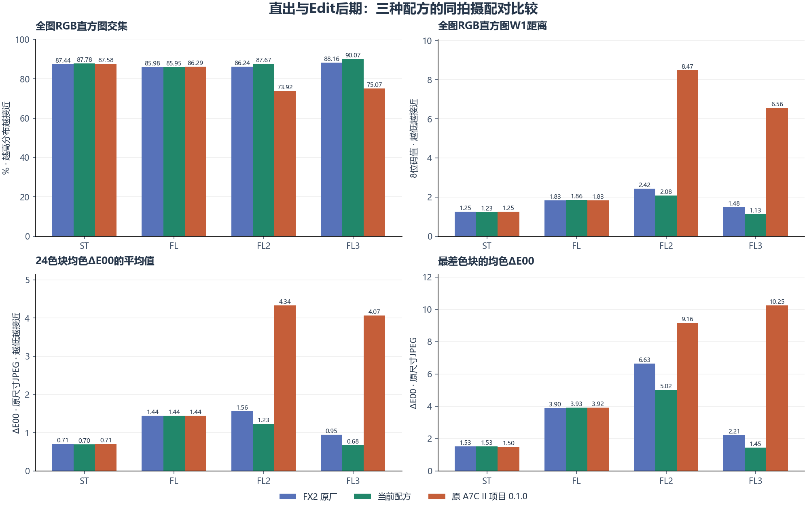

# Sony A7 IV 自定义固件、Fastboot 工具与研究方法

[English](README.en.md) · 中文

针对 **Sony ILCE-7M4（A7 IV / A7M4）** 的社区研究。提供精简的 Windows fastboot 主机工具、可审查的源码和五份独立方法。与索尼公司无隶属关系。主要补丁源于 **A7M4 官方 6.02**；FL2/FL3 供体为 **FX2 1.01**。各方法按文件哈希严格识别支持基线。自定义功能按方法和验收阶段说明，最终发布版本由统一打包确定。

## 先读风险与备份要求

**刷机可能造成永久变砖、无法开机、校准或配置丢失，接线错误还可能损坏相机和电脑。你需要自行承担风险。不要把本项目用于无法承担损失的设备。** 有效签名、脚本运行成功或菜单出现，都不等于刷写安全或功能完整。

- **固件更新（包括 SD 卡更新和恢复更新）必须使用索尼原厂电池，禁止使用副厂电池进行更新。** 即使已安装副厂电池电量/提示补丁，也必须遵守；同时满足更新器电量要求并保持稳定供电。
- **任何刷写前必须备份自己的相机**：保存全部 eMMC 分区、boot0/boot1、分区表和 SHA-256，至少另存一份离线副本。涉及 FL2/FL3 时，还要独立备份物理 CP NOR。保留原厂升级包、工具版本、改动清单与回滚镜像。
- 主机工具强制验证本次连接的完整 eMMC 分区备份，才允许维护写入；写后进行完整分区读回 SHA-256 校验。备份覆盖 payload 列出的分区，并非整颗芯片所有地址。**它不包含独立 CP NOR、其他 MCU 或所有硬件状态**，也不保证任何故障都可恢复。
- 保持可靠供电与 USB 连接，不在写入时拔线、断电或强制退出。不要用另一台相机的完整设置、校准或 eMMC 镜像恢复你的机身。
- **刷机需要一条自制刷机线**：相机 Multi 接口引出线 + RP2040-Zero 启动桥 + 共地与正确的电平接口；普通 USB 数据线不能代替。请先读 [接线说明](docs/wiring.md)。相机 Multi 串行信号电平约 **3.15 V**，RP2040 为 3.3 V 器件；按接线说明使用开漏模式并核对信号上拉与 RESET 接法。
- 不支持把本机固定地址补丁直接套用到其他机型或固件版本；版本号相近也不表示二进制兼容。

## 五个独立方法

| 方法 | 单独入口 | 本仓库提供的内容 | 备注与验证范围 |
|---|---|---|---|
| 1. 取代官方更新公钥，并修改公钥真实性验证 | [中文](methods/01-custom-signing/README.md) / [English](methods/01-custom-signing/README.en.md) | 从本机更新器镜像替换 PEM，校验四库原函数后修改 `verifyKey`，重建 SquashFS/校验和；发布维护者原有密钥对和 DAT 重新签名工具 | 不会自动安装 FL2/FL3。 |
| 2. 自行设置报告的固件版本 | [中文](methods/02-firmware-version/README.md) / [English](methods/02-firmware-version/README.en.md) | 解析本机 FAT，修改 `updater/dat4` 的两字节 BCD，支持 `0.00`–`9.99`，保留其余内容 | 只修改报告版本，不会使旧程序自动具备新功能。 |
| 3. FL2 / FL3 移植与刷入 | [中文](methods/03-fl2-fl3/README.md) / [English](methods/03-fl2-fl3/README.en.md) | AP/CP、供体数据转换、配置及 NOR 同步；**固定 A1 已有实拍对照，颜色接近软件重选目标** | **默认固定 A1**；外观数据取自 FX2，实拍接近 Edit 重选目标，不宣称像素完全相同或 FX2 全场景等效。[安装前提与 SD 迁移修复](methods/03-fl2-fl3/sd-colour-preservation.md)。RAW 无损写出修复后新拍两外观各105项主矩阵匹配 A1；独立 RAW 配方只接受列明完整源 CP 哈希，不自动合入公开官方6.02基线构建。 |
| 4. 副厂电池电量显示与提示限制 | [中文](methods/04-third-party-battery/README.md) / [English](methods/04-third-party-battery/README.en.md) | 16条 AP 指令恢复真实电量显示、跳过副厂提示，保留认证源状态与充电/温度保护；附精确配方、离线补丁与回滚 | 独立提供原理、基线、补丁与验证；SD 构建显式传入 `--battery` 才合并。**更新仍必须使用原厂电池。** |
| 5. 镜头 AF 机制与兼容能力过滤 | [中文](methods/05-third-party-lens-af/README.md) / [English](methods/05-third-party-lens-af/README.en.md) | 分别分析 ID 能力过滤与类别/能力/档案范围门控；六处 CP 补丁仅保留上报能力和速度 profile，范围门控未修改；**速度改善未经实机测试** | **对焦速度改善未经实机测试，效果未知。** 独立基线与验证边界；SD 构建显式传入 `--lens-af` 才合并。 |

## 固定条件实拍色彩对比

[完整报告：FX2 原厂 / 当前配方 / 原 A7C II 项目 0.1.0](docs/fl23-colour-comparison-20261018/README.md) · [指标 CSV](docs/fl23-colour-comparison-20261018/指标汇总.csv) · [测量方法与离线 HTML](docs/fl23-colour-comparison-20261018/METHODS.md)

固定光圈、快门、ISO、白平衡与镜头，共12对机内直出/Edit后期图。原尺寸24块平均色差 ΔE00 越低，表示越接近本次 Edit 参考。

| 方案 | FL 均色 ΔE00 ↓ | FL2 均色 ΔE00 ↓ | FL3 均色 ΔE00 ↓ |
| --- | --- | --- | --- |
| FX2 原厂 | 1.444 | 1.565 | 0.951 |
| 当前配方 | 1.444 | 1.233 | 0.678 |
| 原 A7C II 项目 0.1.0 | 1.444 | 4.336 | 4.070 |



本场景、光源下当前配方最接近参考，FL2黄/橙色块仍有残差。全部照片来自 A7M4，不是实体 FX2/A7C II 对拍，也不代表跨光源通用排名或真实色彩准确度。

<!-- FL23_V2_RECIPE_NOTE -->报告已补充色度系数、三光源矩阵示例及 Gamma 差异；核对上游 v2.0 后确认 FL2/FL3 配方资产与历史0.1.0包逐字节相同。v2.0没有新增实拍组。

<!-- FL_REPORT_NOTE -->

新增FL专项对比：三组均色ΔE00均约1.444，局部残差相近，不据此进行FL配方排名。

## Fastboot 工具

保留完整备份、版本查看/设置、自签更新器构建、同机备份恢复和恢复官方验签。`advanced/` 提供中文 BAT 入口。**不包含交互串口控制台、串口命令行、任意 UART 命令或串口更新模式切换。** RP2040 的串行启动传输仍是进入 fastboot 必需的硬件协议，不是相机控制台功能。

Windows 10/11、Python 3.11+。克隆仓库后：

```powershell
py -3 -m venv .venv
.\.venv\Scripts\python.exe -m pip install -e .
```

按 [环境与外部资源](docs/setup.md) 准备 fastboot、RP2040 UF2、相机启动 payload、驱动和 SquashFS 工具。仓库不捆绑这些外部二进制，不提供索尼完整固件或机身备份。

```powershell
# 纯模拟，无相机、驱动或串口操作
.\.venv\Scripts\python.exe -m a7m4 --demo maintain
# 检查本地资源，不操作设备
.\.venv\Scripts\python.exe -m a7m4 doctor
# 实机入口：先进入 fastboot 并完整备份，再显示维护菜单
.\.venv\Scripts\python.exe -m a7m4 maintain
```

也可运行 `setup.bat` 安装 Python 依赖，然后运行 `advanced/进阶维护菜单.bat`。每个写入操作都会显示分区、原/目标哈希和与该计划绑定的完整确认文字。已在 fastboot 的用户可用 `maintain --already-fastboot`；完整备份要求仍然有效。

## 公开密钥与发布边界

维护者明确授权发布自己此前使用的 [RSA 密钥对](keys/published/README.md)。**私钥已公开，任何人都能用它签名；使用此公钥的更新器不再能通过签名辨认发布者。** 请自行审核包内容；如需独立信任身份，生成自己的密钥并离线保存私钥。

本仓库公开原创主机源码、补丁配方、说明和指定实验密钥。索尼固件、供体曲线/矩阵、个人校准、机身备份和外部驱动应由使用者自行取得。源码采用 [MIT](LICENSE)，第三方内容依其原许可，见 [第三方说明](THIRD_PARTY_NOTICES.md)。上游部分公开研究仓库没有明确再分发许可，因此这里只链接来源，不把其 payload 重新打包为本项目的 MIT 软件。

## 参考项目与致谢

本次公开内容直接使用或参考的项目如下；具体用途、来源修订和运行依赖/研究工具的区别见 [完整参考清单](REFERENCES.md)。

| 项目 | 使用或参考内容 |
|---|---|
| [DavidBuchanan314/ILCE-7M4-RE](https://github.com/DavidBuchanan314/ILCE-7M4-RE) | 串行启动、RP2040 桥、相机 fastboot payload、eMMC 访问。 |
| [QAQLeonard/a7c2-fl23-research](https://github.com/QAQLeonard/a7c2-fl23-research) | A7C II 的 FL2/FL3 参数与安装研究；历史0.1.0配方作为本次 A7M4 对照。未在本仓库打包其 USB payload 或源码。 |
| [DavidBuchanan314/fwtool.py，a7iv 分支](https://github.com/DavidBuchanan314/fwtool.py/tree/a7iv) 与 [ma1co/fwtool.py](https://github.com/ma1co/fwtool.py) | 升级包格式、解包与研究。 |
| [ma1co/Sony-PMCA-RE](https://github.com/ma1co/Sony-PMCA-RE) | 索尼相机协议与固件研究背景。 |
| [ExifTool](https://exiftool.org/) 的 [Sony LensType2 表](https://exiftool.org/TagNames/Sony.html) | 镜头 ID 类别的研究参考，不代替实际镜头采样。 |
| [q19032/Sony-firmware-unpacker](https://github.com/q19032/Sony-firmware-unpacker) | 固件解密与密钥推导研究参考。 |
| [DavidBuchanan314/Sony-ILCE-7M4-Linux](https://github.com/DavidBuchanan314/Sony-ILCE-7M4-Linux) | 平台 Linux 参考源码。 |
| [AOSP fastboot](https://android.googlesource.com/platform/system/core/+/refs/heads/main/fastboot/) 与 [squashfs-tools-ng](https://github.com/AgentD/squashfs-tools-ng) | 主机 USB 工具与更新器文件系统重建。 |
| [arduino-pico](https://github.com/earlephilhower/arduino-pico)、[Pico SDK](https://github.com/raspberrypi/pico-sdk) | RP2040 构建依赖。 |
| [pySerial](https://github.com/pyserial/pyserial)、[pyelftools](https://github.com/eliben/pyelftools)、[cryptography](https://github.com/pyca/cryptography) | 主机运行依赖。 |
| [Dissect](https://github.com/fox-it/dissect)、[PyCryptodome](https://github.com/Legrandin/pycryptodome)、[Capstone](https://github.com/capstone-engine/capstone)、[Unicorn](https://github.com/unicorn-engine/unicorn)、[Keystone](https://github.com/keystone-engine/keystone) | 离线文件系统、封装、反汇编、指令重放与补丁研究。 |
| [Python](https://github.com/python/cpython)、[pytest](https://github.com/pytest-dev/pytest)、[setuptools](https://github.com/pypa/setuptools) | 语言、测试与打包工具。 |
| [NumPy](https://github.com/numpy/numpy)、[Dissect extfs](https://github.com/fox-it/dissect.extfs)、[util](https://github.com/fox-it/dissect.util)、[cstruct](https://github.com/fox-it/dissect.cstruct) | 可选完整固件构建依赖。 |
| [Arduino CLI](https://github.com/arduino/arduino-cli)、[GCC](https://gcc.gnu.org/)、[GNU Binutils](https://www.gnu.org/software/binutils/) | 外部桥/payload 构建工具；[OpenSSL](https://github.com/openssl/openssl)、[cffi](https://github.com/python-cffi/cffi)、[pycparser](https://github.com/eliben/pycparser)、[pip](https://github.com/pypa/pip)：加密与安装链依赖。 |
| [Pillow](https://github.com/python-pillow/Pillow), [Matplotlib](https://github.com/matplotlib/matplotlib) | 离线照片解码、独立直方图核对与报告图表；不属于刷写主机运行依赖。 |
| [Sharma / Wu / Dalal CIEDE2000](https://hajim.rochester.edu/ece/sites/gsharma/ciede2000/) | 34组色差参考数据用于算法验证；研究引用，不复制上游代码或数据。 |

## 验证与贡献

```powershell
python -m pip install -e ".[test]"
python -m pytest -q
python tools/check_public_tree.py
```

测试使用合成数据，不会连接相机。历史实机反馈、当前离线复现和未验证项在各方法及 [验证说明](docs/validation.md) 中分别列出。精简后的工具尚未完成一次新的实机刷写验收。贡献新基线时请提交地址映射、输入哈希、差分和验证依据；不要提交他人的私钥、机身数据或完整固件。
