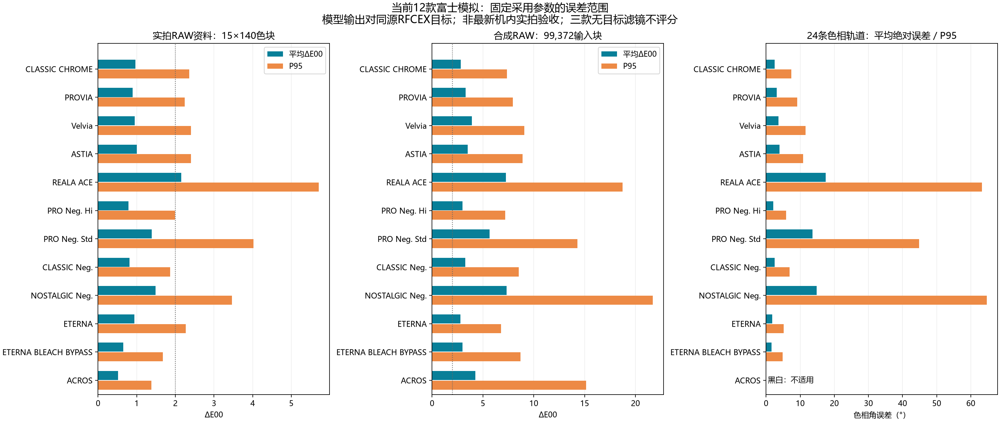

# Selected custom looks: current training results and errors

[中文](README.md) · [Using LUTs](../../methods/08-custom-lut/README.en.md) · [Scores CSV](scores.csv) · [Results JSON](results.json) · [Agent training guide](AGENT_TRAINING.en.md)

**Updated 2026-11-09. This page replaces the earlier-stage report and identifies the current 15 JSON looks by SHA-256. Twelve Fujifilm simulations have paired RFCEX targets; the other three retain their original parameters and remain unassessed.**

**These scores compare M4 model output from existing real-camera RAWs with Fujifilm RFCEX TIFFs produced from the same RAWs via RAF conversion. They are not new on-camera acceptance results for this 15-look package.** The data have been used for training, selection and protection, rather than independent blind testing.

The macro-average of the twelve chart mean ΔE00 values is **1.0445**. **9/12** meet both mean≤2 and P95≤3 on that chart set. This does not bound the maximum or establish whole-gamut or unseen-scene accuracy.

## 1. Existing real-camera chart data: 15 × 140 patches per look

Each patch has equal weight. The 15 images include repeats and are not 15 independent lighting/exposure conditions.

| Look | Mean ΔE00 | P95 | Maximum ΔE00 | RGB RMSE / 255 |
|---|---|---|---|---|
| CLASSIC CHROME | 0.9645 | 2.3573 | 6.1007 | 1.7499 |
| PROVIA | 0.8903 | 2.2424 | 6.2052 | 1.9655 |
| Velvia | 0.9443 | 2.4081 | 7.1202 | 2.9805 |
| ASTIA | 0.9985 | 2.4020 | 7.4676 | 2.2410 |
| REALA ACE | 2.1529 | 5.7070 | 10.5504 | 4.6945 |
| PRO Neg. Hi | 0.7879 | 1.9922 | 5.2166 | 1.5182 |
| PRO Neg. Std | 1.3928 | 4.0175 | 7.1586 | 2.7467 |
| CLASSIC Neg. | 0.8158 | 1.8683 | 9.5838 | 1.6115 |
| NOSTALGIC Neg. | 1.4873 | 3.4655 | 6.9480 | 3.6640 |
| ETERNA | 0.9359 | 2.2722 | 6.4762 | 1.5281 |
| ETERNA BLEACH BYPASS | 0.6498 | 1.6760 | 7.1108 | 1.3558 |
| ACROS | 0.5140 | 1.3836 | 4.7759 | 1.6862 |
| 理光正片 | — | — | — | — |
| 理光负片 | — | — | — | — |
| Portra400NB | — | — | — | — |

## 2. Historical ROIs, including materials and skin shadows

There are 2,194 ROIs per measured look, including the 2,100 chart patches above. These sets overlap and must not be added as independent samples.

| Look | Mean ΔE00 | P95 | Maximum ΔE00 | RGB RMSE / 255 |
|---|---|---|---|---|
| CLASSIC CHROME | 0.9557 | 2.3406 | 6.1007 | 1.7318 |
| PROVIA | 0.8815 | 2.2038 | 6.2052 | 1.9536 |
| Velvia | 0.9390 | 2.3913 | 7.1202 | 2.9543 |
| ASTIA | 0.9849 | 2.3673 | 7.4676 | 2.2207 |
| REALA ACE | 2.1213 | 5.6488 | 10.5504 | 4.6661 |
| PRO Neg. Hi | 0.7808 | 1.9720 | 5.2166 | 1.5022 |
| PRO Neg. Std | 1.3757 | 3.9795 | 7.1586 | 2.7357 |
| CLASSIC Neg. | 0.8062 | 1.8488 | 9.5838 | 1.6378 |
| NOSTALGIC Neg. | 1.4646 | 3.4480 | 6.9480 | 3.6463 |
| ETERNA | 0.9264 | 2.2502 | 6.4762 | 1.5333 |
| ETERNA BLEACH BYPASS | 0.6427 | 1.6462 | 7.1108 | 1.3441 |
| ACROS | 0.5124 | 1.3846 | 4.7759 | 1.6774 |
| 理光正片 | — | — | — | — |
| 理光负片 | — | — | — | — |
| Portra400NB | — | — | — | — |

Shadow subsets also overlap the historical set:

| Look | Shadow mean ΔE00 | Shadow P95 | Skin-shadow mean ΔE00 | Skin-shadow P95 |
|---|---|---|---|---|
| CLASSIC CHROME | 0.8533 | 2.1908 | 0.6307 | 0.9821 |
| PROVIA | 0.6770 | 1.5874 | 0.3413 | 0.5890 |
| Velvia | 0.8450 | 1.8978 | 0.4695 | 0.5421 |
| ASTIA | 0.8135 | 1.9211 | 0.5679 | 0.8876 |
| REALA ACE | 1.5247 | 4.0878 | 0.9461 | 1.6490 |
| PRO Neg. Hi | 0.5853 | 1.4320 | 0.3309 | 0.4859 |
| PRO Neg. Std | 0.8731 | 2.4247 | 0.5233 | 1.2410 |
| CLASSIC Neg. | 0.7079 | 1.4890 | 0.3459 | 0.5929 |
| NOSTALGIC Neg. | 1.2346 | 2.6542 | 0.6129 | 1.0099 |
| ETERNA | 0.7689 | 1.7041 | 0.3536 | 0.4903 |
| ETERNA BLEACH BYPASS | 0.4677 | 1.0963 | 0.4142 | 0.5755 |
| ACROS | 0.2928 | 0.6584 | 0.3159 | 0.5424 |

## 3. Synthetic RAW gamut: 99,372 inputs per look

The input is the actual CFA/metadata mapping of SONY-v4.5-100MP-5300K.ARW, not design RGB substituted for RAW. Saturated and extreme colours make this set harder than the physical chart. CC uses the controlled as-shot target; other looks retain their registered historical targets.

| Look | Mean ΔE00 | P95 | Maximum ΔE00 | RGB RMSE / 255 |
|---|---|---|---|---|
| CLASSIC CHROME | 2.8046 | 7.3476 | 19.1481 | 10.6475 |
| PROVIA | 3.3146 | 7.9295 | 20.4745 | 15.5007 |
| Velvia | 3.9038 | 9.0551 | 18.0233 | 19.2034 |
| ASTIA | 3.4994 | 8.8990 | 20.8054 | 15.7822 |
| REALA ACE | 7.2661 | 18.7451 | 48.3892 | 38.0997 |
| PRO Neg. Hi | 3.0030 | 7.1796 | 20.8319 | 13.2410 |
| PRO Neg. Std | 5.6686 | 14.3092 | 29.1963 | 26.1704 |
| CLASSIC Neg. | 3.2538 | 8.5207 | 26.6263 | 12.2964 |
| NOSTALGIC Neg. | 7.3319 | 21.6897 | 48.5536 | 34.6109 |
| ETERNA | 2.7971 | 6.7730 | 17.9767 | 11.0336 |
| ETERNA BLEACH BYPASS | 2.9750 | 8.6811 | 20.2845 | 7.8125 |
| ACROS | 4.2562 | 15.1437 | 25.5836 | 16.1519 |
| 理光正片 | — | — | — | — |
| 理光负片 | — | — | — | — |
| Portra400NB | — | — | — | — |

Hue errors are in degrees, not ΔE00, across 24 fixed-input-hue brightness tracks. Fixed target-valid masks and candidate loss-of-chroma penalties are retained. Hue is not meaningful for ACROS.

| Look | Hue MAE / degrees | Hue P95 / degrees |
|---|---|---|
| CLASSIC CHROME | 2.5430 | 7.3944 |
| PROVIA | 3.0981 | 9.1003 |
| Velvia | 3.6665 | 11.5158 |
| ASTIA | 3.8997 | 10.8786 |
| REALA ACE | 17.4905 | 63.2287 |
| PRO Neg. Hi | 2.0627 | 5.8786 |
| PRO Neg. Std | 13.5863 | 44.8531 |
| CLASSIC Neg. | 2.5076 | 6.9262 |
| NOSTALGIC Neg. | 14.8001 | 64.6468 |
| ETERNA | 1.8432 | 5.1834 |
| ETERNA BLEACH BYPASS | 1.5948 | 4.8345 |
| ACROS | N/A | N/A |

REALA ACE, NOSTALGIC Neg. and PRO Neg. Std still have substantial gamut and hue tails. The current looks do not achieve mean≤2 or maximum≤3 throughout this gamut.

## 4. Neutral-to-shadow response

Gray-axis points are selected at target L*=5..35. Different film tone curves produce different point counts, so these are not identical sample sets for ranking.

| Look | Points | Mean ΔE00 | L* RMSE | a* RMSE | b* RMSE | C*ab RMSE |
|---|---|---|---|---|---|---|
| CLASSIC CHROME | 40 | 0.5741 | 0.4811 | 0.3167 | 0.2901 | 0.2025 |
| PROVIA | 43 | 3.2413 | 0.3443 | 2.4894 | 0.4815 | 2.1009 |
| Velvia | 34 | 3.8680 | 0.7397 | 3.1038 | 0.7273 | 3.0455 |
| ASTIA | 41 | 3.2202 | 0.4689 | 2.5124 | 0.6906 | 2.1106 |
| REALA ACE | 44 | 3.2247 | 1.2640 | 2.2806 | 0.9028 | 1.6923 |
| PRO Neg. Hi | 37 | 2.9761 | 0.4162 | 2.2542 | 0.6475 | 2.0546 |
| PRO Neg. Std | 44 | 2.5445 | 0.6580 | 1.8832 | 0.6585 | 1.0725 |
| CLASSIC Neg. | 44 | 2.1639 | 0.4930 | 1.8039 | 0.4693 | 1.5538 |
| NOSTALGIC Neg. | 44 | 3.0823 | 0.5779 | 2.2561 | 0.4885 | 0.7714 |
| ETERNA | 53 | 1.6926 | 0.5487 | 1.2705 | 0.4088 | 0.9319 |
| ETERNA BLEACH BYPASS | 49 | 1.4559 | 0.4300 | 1.1286 | 0.3895 | 0.4796 |
| ACROS | 42 | 0.5890 | 0.8133 | 0.1350 | 0.1813 | 0.2030 |

The older CC target matches manual 6710K/Tint23; the controlled as-shot target records 6710K/Tint18. This is the same current JSON evaluated against different targets, not an optimisation gain:

| CC target | Mean ΔE00 | P95 | Maximum ΔE00 |
|---|---|---|---|
| as_shot | 2.8046 | 7.3476 | 19.1481 |
| legacy_Tint23 | 2.9244 | 7.1517 | 19.1442 |

## 5. Supplementary 140-patch chart

Nine looks have a further paired 140-patch target used for selection/protection. This is not a blind test. Pro Neg. Std, Nostalgic Neg. and Acros have no target in this particular group; their main chart results above still exist.

| Look | Mean ΔE00 | P95 | Maximum ΔE00 | RGB RMSE / 255 |
|---|---|---|---|---|
| CLASSIC CHROME | 1.0654 | 2.1319 | 3.2129 | 2.0938 |
| PROVIA | 1.1482 | 2.5955 | 4.1060 | 2.7890 |
| Velvia | 1.1388 | 2.3519 | 4.5016 | 3.6202 |
| ASTIA | 1.1966 | 2.2494 | 4.7164 | 2.6292 |
| REALA ACE | 2.6408 | 7.1618 | 9.2448 | 5.1289 |
| PRO Neg. Hi | 1.1016 | 2.3818 | 4.4246 | 2.2490 |
| CLASSIC Neg. | 0.8926 | 1.6713 | 3.4028 | 2.0593 |
| ETERNA | 1.1743 | 2.2674 | 3.8264 | 1.9253 |
| ETERNA BLEACH BYPASS | 0.7615 | 1.7143 | 2.4472 | 1.5636 |

## 6. Current file identities

Initial provenance identifies the original starting point only. Later M4 refinement means initial on-camera scores cannot be reused as scores for these current parameters. Full hashes are in results.json; finished JSON looks are distributed separately through Releases.

| File | Initial provenance | Current status | SHA-256 prefix |
|---|---|---|---|
| CLASSIC CHROME.json | R5 adaptation | M4-refined | `8ea00e3edcf2` |
| PROVIA.json | R5 adaptation | M4-refined | `6f19114c1493` |
| Velvia.json | R5 adaptation | M4-refined | `ca69cb7d8f83` |
| ASTIA.json | R5 adaptation | M4-refined | `af4a71eda6b2` |
| REALA ACE.json | M4 fitting | M4-refined | `8bcdd3f6389c` |
| PRO Neg. Hi.json | R5 adaptation | M4-refined | `45c8e316aebf` |
| PRO Neg. Std.json | M4 fitting | M4-refined | `44552f5594c3` |
| CLASSIC Neg.json | R5 adaptation | M4-refined | `7f851b87ca86` |
| NOSTALGIC Neg.json | M4 fitting | M4-refined | `76db7ca8bd81` |
| ETERNA.json | R5 adaptation | M4-refined | `9074c8cb458d` |
| ETERNA BLEACH BYPASS.json | R5 adaptation | M4-refined | `8f8af7085b2f` |
| ACROS.json | M4 fitting | M4-refined | `2e2b65403078` |
| 理光正片.json | R5 adaptation | Unchanged; unassessed | `9ac9b6839f93` |
| 理光负片.json | R5 adaptation | Unchanged; unassessed | `58a2804dd942` |
| Portra400NB.json | R5 adaptation | Unchanged; unassessed | `f4e3bbc28f60` |

## 7. Metrics and reproduction scope

- ΔE00 uses sRGB→D65 CIELAB and CIEDE2000 with kL=kC=kH=1. P95 is the 95th percentile. RGB RMSE is measured on encoded 0..255 sRGB codes; real-scene entries use ROI means, not a whole-image pixel error.
- Scores are reaggregated from the RGB16 replay results matching the current parameters. No model/filter training, target replacement, exposure/WB normalisation or added lens correction was performed for this report.
- Chart, historical, supplementary and synthetic-gamut sets remain separate. Historical material, skin-shadow and chart subsets overlap.
- Only CC has the controlled as-shot target confirmation. The other eleven targets retain historical WB settings that have not been independently confirmed per look. Changing targets is not a training gain.
- Model-to-camera agreement and look-to-Fuji matching are different measurements. This report covers the latter; it does not establish equivalence to a real Fujifilm body across every lens, light or ISO.

See the [training entry](../../training/README.en.md) and [Agent guide](AGENT_TRAINING.en.md). [results.json](results.json) records full current-file hashes, the model identity, source-statistics identity and per-condition scores.

## Acknowledgements

Special thanks to [Hearts-Ace](https://github.com/Hearts-Ace/sony-a7r5-custom-firmware) for substantial support with training methodology, native parameters, grid search and synthetic dense-chart research, and to [751K/sony-look-bridge](https://github.com/751K/sony-look-bridge) for native-rendering implementations. This report includes no finished-look JSONs, personal photographs, target TIFFs, model weights or Sony executables/runtime constants.
