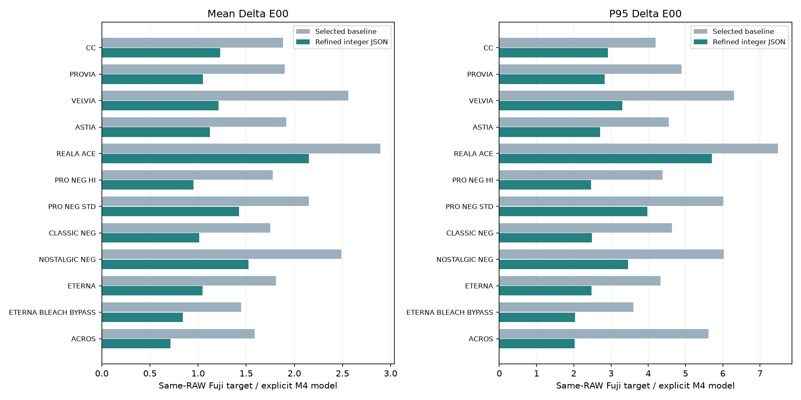
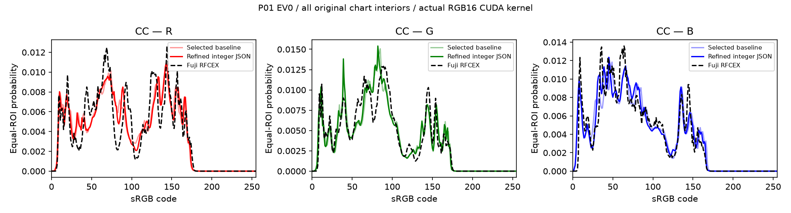

# 精选自定义滤镜：训练结果

[English](README.en.md) · [自定义LUT使用方法](../../methods/08-custom-lut/README.md) · [评分CSV](scores.csv) · [机器可读结果](results.json)

12款富士风格在M4电脑模型中继续拟合，等权平均ΔE00从 **2.014降至1.190（下降40.9%）**。各款阴影与肤色阴影均值均下降。本页记录2026-11-08的离线评估，**新参数的机内实拍效果尚待验证**。

本次仅发布结果与统计图。滤镜JSON由维护者后续通过[Releases](https://github.com/Erlla/sony-a7m4-custom-firmware/releases)提供；理光正片、理光负片和Portra400NB不参与本轮优化。

## 逐款评分

每款20条件、2194个ROI均值；42份已有RAW形成240组风格/条件目标。覆盖曝光、三种光源/白平衡、ISO和材质。ΔE00采用sRGB→D65 CIELAB、kL=kC=kH=1；RGB RMSE按0～255的ROI均值定义。

| 风格 | 平均ΔE00 | P95 | 最大ΔE00 | RGB均值RMSE |
|---|---:|---:|---:|---:|
| CLASSIC CHROME | 1.881 → 1.228 | 4.192 → 2.913 | 10.975 → 7.132 | 3.470 → 2.571 |
| PROVIA | 1.900 → 1.048 | 4.887 → 2.829 | 13.512 → 8.998 | 5.288 → 3.318 |
| Velvia | 2.559 → 1.215 | 6.306 → 3.302 | 19.063 → 11.888 | 6.872 → 4.907 |
| ASTIA | 1.918 → 1.122 | 4.548 → 2.711 | 11.972 → 9.226 | 4.826 → 3.095 |
| REALA ACE | 2.894 → 2.152 | 7.478 → 5.703 | 15.095 → 10.557 | 6.626 → 4.767 |
| PRO Neg. Hi | 1.777 → 0.953 | 4.384 → 2.466 | 13.820 → 8.942 | 4.186 → 2.629 |
| PRO Neg. Std | 2.152 → 1.426 | 6.011 → 3.977 | 10.371 → 7.156 | 4.493 → 2.864 |
| CLASSIC Neg. | 1.750 → 1.011 | 4.640 → 2.488 | 13.087 → 12.523 | 3.608 → 2.628 |
| NOSTALGIC Neg. | 2.487 → 1.523 | 6.026 → 3.459 | 11.453 → 7.799 | 6.836 → 3.846 |
| ETERNA | 1.811 → 1.046 | 4.331 → 2.474 | 9.203 → 6.675 | 2.712 → 1.993 |
| ETERNA BLEACH BYPASS | 1.447 → 0.842 | 3.600 → 2.035 | 9.885 → 7.760 | 2.492 → 1.709 |
| ACROS | 1.589 → 0.715 | 5.619 → 2.027 | 13.824 → 7.652 | 7.043 → 2.307 |

## 阴影与回归条件

| 风格 | 阴影均值 | 肤色阴影均值 | 七项回归条件均值 |
|---|---:|---:|---:|
| CLASSIC CHROME | 1.733 → 1.075 | 1.713 → 0.720 | 1.919 → 1.283 |
| PROVIA | 1.445 → 0.721 | 1.393 → 0.422 | 2.249 → 1.248 |
| Velvia | 2.062 → 0.914 | 2.384 → 0.487 | 2.971 → 1.497 |
| ASTIA | 1.544 → 0.886 | 1.446 → 0.604 | 2.202 → 1.262 |
| REALA ACE | 2.018 → 1.539 | 1.126 → 0.967 | 3.350 → 2.288 |
| PRO Neg. Hi | 1.436 → 0.664 | 1.930 → 0.366 | 2.028 → 1.115 |
| PRO Neg. Std | 1.246 → 0.899 | 1.056 → 0.610 | 2.476 → 1.419 |
| CLASSIC Neg. | 1.323 → 0.792 | 1.509 → 0.415 | 2.020 → 1.265 |
| NOSTALGIC Neg. | 1.906 → 1.279 | 1.354 → 0.577 | 2.734 → 1.597 |
| ETERNA | 1.635 → 0.838 | 1.405 → 0.402 | 1.780 → 1.128 |
| ETERNA BLEACH BYPASS | 1.141 → 0.666 | 1.132 → 0.495 | 1.578 → 0.976 |
| ACROS | 0.655 → 0.347 | 2.155 → 0.522 | 2.000 → 0.926 |

第一轮13个条件参与梯度，7个历史条件用于候选筛选。REALA ACE、PRO Neg. Std和NOSTALGIC Neg.的第二轮将这些目标纳入约束求解；其余九款保持第一轮选型。所有资料均为已观察的历史数据，本表不作为盲测。验收容差允许个别误差略增（均值0.015、P95为0.04、最大值0.08），最终结果未放宽该条件。

## RGB分布

取6500K、EV0色卡的全部原始内部像素，每个ROI等权；浅色为原精选参数、实线为新整数JSON、黑色虚线为富士软件目标。RGB16正式CUDA内核生成这些像素，直方图分布距离与整组评分收据相同。逐色块ΔE00与RGB分布共同报告。

[CLASSIC CHROME](images/CC_RGB.png) · [PROVIA](images/PROVIA_RGB.png) · [Velvia](images/VELVIA_RGB.png) · [ASTIA](images/ASTIA_RGB.png) · [REALA ACE](images/REALA_ACE_RGB.png) · [PRO Neg. Hi](images/PRO_NEG_HI_RGB.png) · [PRO Neg. Std](images/PRO_NEG_STD_RGB.png) · [CLASSIC Neg.](images/CLASSIC_NEG_RGB.png) · [NOSTALGIC Neg.](images/NOSTALGIC_NEG_RGB.png) · [ETERNA](images/ETERNA_RGB.png) · [ETERNA BLEACH BYPASS](images/ETERNA_BLEACH_BYPASS_RGB.png) · [ACROS](images/ACROS_RGB.png)

## 拟合与评估方法

- 目标来自同一索尼ARW转换的RAF，再由富士RAW FILE CONVERTER EX对应胶片模拟导出16位sRGB TIFF；它表示该软件处理链的目标，不是富士相机同场景实拍对照。
- 起点为精选包实际参数，八款来自已适配的R5参考、四款来自本工程。使用明确Edit算子的原生前段，颜色网格采用V4零网格桥接及已标定的冻结神经响应；本轮不重新训练响应网络。
- 优化1215项signed7网格（3×5×9×9，−64～63，相对起点±16），保留Gamma、矩阵、基础系数和默认微调；拍照/预览网格同步。第一轮两次1800步，三款补充约束求解各两次1200步。
- 原始ROI像素在129³实际出图表节点聚合；带12像素邻域的图集与全图核对3,200,072像素完全相同。12款整数结果重载后用正式内核复核799,536,917个ROI像素，评分最大偏差1.83×10⁻⁵。
- 电脑处理不加镜头校正，不做曝光/白平衡归一化。历史原片的拍摄设置保持原样。

## 模型与已有机内照片的对照

12份未进入本轮拟合的历史RAW/JPEG，在原精选参数下对照140个24×24色卡中心。这里测量模型对旧参数的复现误差；新候选的机内精度需另行确认。极端条件下仍存在较大的最大误差，尚未实现全部色块ΔE00低于3。

| 风格 | 模型/机内平均ΔE00 | P95 | RGB均值RMSE |
|---|---:|---:|---:|
| CC | 0.821 | 1.976 | 1.571 |
| PROVIA | 1.185 | 3.674 | 3.752 |
| VELVIA | 1.462 | 4.267 | 4.883 |
| ASTIA | 1.085 | 3.128 | 3.188 |
| REALA_ACE | 0.650 | 1.230 | 1.317 |
| PRO_NEG_HI | 0.983 | 2.822 | 2.129 |
| PRO_NEG_STD | 0.730 | 1.461 | 1.306 |
| CLASSIC_NEG | 0.905 | 1.569 | 2.449 |
| NOSTALGIC_NEG | 0.710 | 1.285 | 1.896 |
| ETERNA | 0.749 | 1.608 | 1.289 |
| ETERNA_BLEACH_BYPASS | 0.747 | 1.407 | 1.310 |
| ACROS | 1.121 | 2.431 | 1.583 |

## 致谢

感谢[751K/sony-look-bridge](https://github.com/751K/sony-look-bridge)的Sony Edit显影算子与创意外观运算实现，为M4电脑模型原生前段提供基础；感谢[Hearts-Ace/sony-a7r5-custom-firmware](https://github.com/Hearts-Ace/sony-a7r5-custom-firmware)的原生参数参考与拟合研究。原片、目标TIFF、权重和Sony程序/常量未随报告分发。
