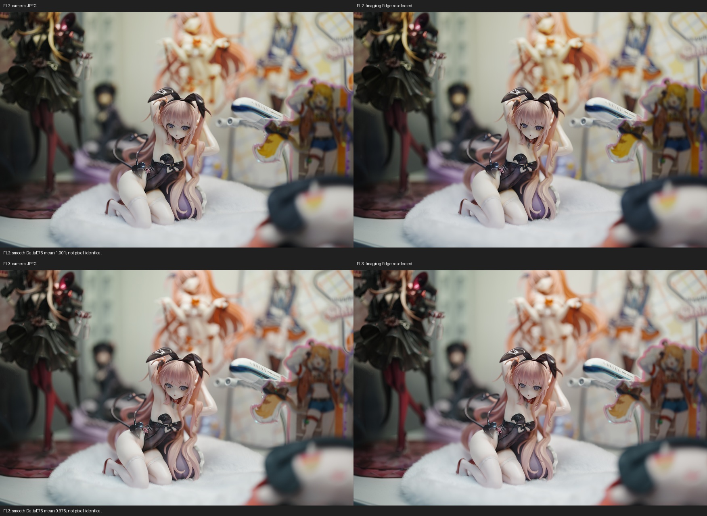
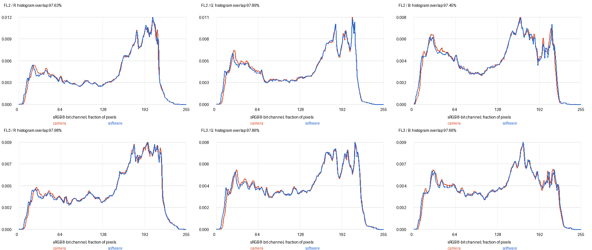
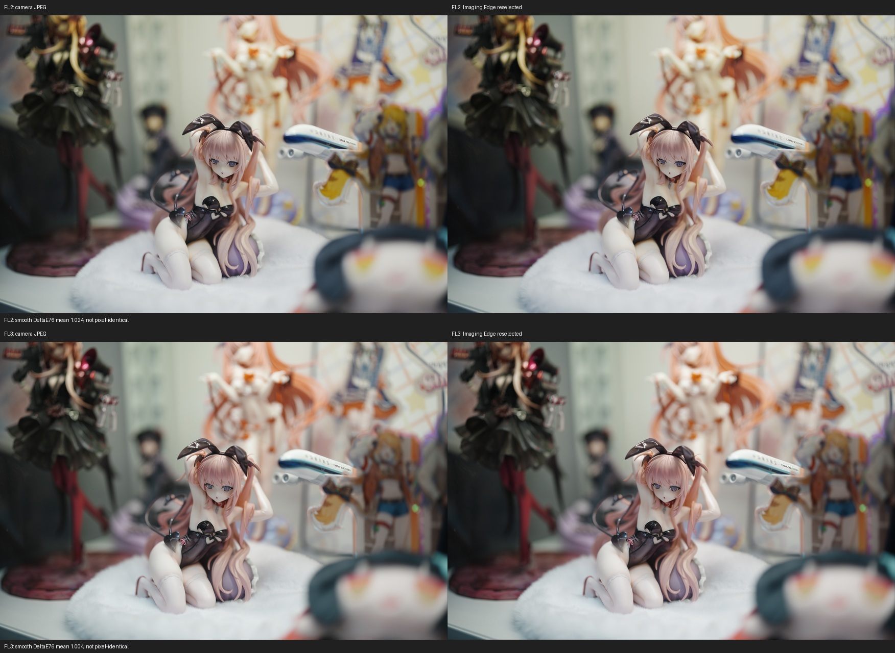
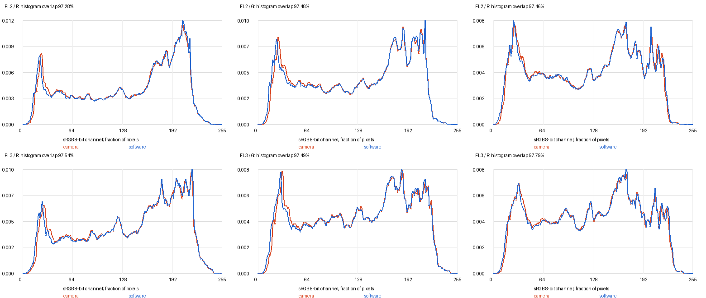

# FL2 / FL3：当前颜色结论与实拍对照

2026-10-17。当前实现的 **FL2/FL3 外观数据与 FX2 原版供体一致**；默认固定各自 A1 后，本次机内直出与 Imaging Edge 重选外观颜色接近，旧版主要偏色已解决。这里的“一致”限定为所核验的外观数据和矩阵选择目标，不能改写成“两个 JPEG 完全没有差异”或“与实体 FX2 全场景等效”。

## 为什么之前不同

1. **比较用的参数不是同一组。** 解锁脚本使 A7M4 RAW 可在 Imaging Edge 中选 FL2/FL3，同时为备选外观写入 FX2 A1 矩阵。原相机走 B/A1/A2 插值，实拍常为 B 或接近 B。软件重新选择外观改用了 A1，因此会偏色；供体表存在不代表运行时已经选到同一矩阵。
2. **这一现象也存在于原有 FL。** 未解锁的原厂 FL 在“直接导出”和“切到 ST 再切回 FL”之间也改变颜色；只将该 RAW 主矩阵替换为它自带的 FL 备选矩阵，即可重现主要差异。不能单凭重选后不同认定新滤镜系数错误。
3. **部署必须闭环。** SD 更新迁移过设置，活动 nfa6 与 BACKUP.BIN/BAK 曾不一致；只线刷 nfa8 也不会同步独立 NOR。须核验四个 bank、三份配置、双处 CP 和正常开机后的持久化。
4. **一个 RAW 整数单位是另一层问题。** 固定 A1 后 FL2 的内部1614可在 M4 的 WB 定点往返写成1615，FX2 有直接写出分支。新候选在中性、主 RAW、校准保护条件下忠实写出原矩阵，未改 JPEG；有界离线验证不是新照片验收。该候选未合入公开6.02配方。

## 当前修改方法

`python -m a7m4.fl23 build` 默认 `--matrix-mode fixed-a1`。四个 bank22/23/24/25 分别对应 FL2照片、FL2视频、FL3照片、FL3视频；每个都将 B/A1/A2 设为本 bank 的原版 A1。CC1差分编码、Gamma、菜单及元数据补丁仍按[主方法](README.md)；保留本机白平衡和传感器校准。`--matrix-mode dynamic` 只保留原动态端点用于研究，不用于本次软件颜色匹配结论。

SD包不嵌入个人颜色/设置。SD更新后，用最新本机回读修复 nfa6、BACKUP.BIN、BACKUP.BAK 并重算BK4校验；核对六条槽值、eMMC和NOR CP，再正常重启回读。不能用旧整分区覆盖新版本/用户配置。本仓库仍只接受列出的原版6.02程序哈希，不会把6.24新代码误当原版处理。

## 当前6.26新RAW结果

6.26安装和启动持久化检查后，用户新拍的DSC02788_FL2.ARW、DSC02789_FL3.ARW均为**105/105项**主矩阵与相应FX2 A1精确相同；FL2的7800右下项现在为1614。见[新证据](../../docs/fl23-626-validation-results-20261017.json)。本节是未经解锁原始主SR2的真实新照片验证，不用备选外观矩阵代替主拍摄参数。新配方只绑定实验6.24完整源，见[方法中的精确源限制](README.md)。

6.26软件导出已补齐，见下一节。更下方仍保留原6.24图区和测量，不将旧图重标成6.26。

## 6.26两组JPEG对照结果

用户随后补齐了DSC02788_FL2、DSC02789_FL3对应的Imaging Edge重选外观导出。配对曝光/时间/焦距一致，软件为Edit 4.1.01.06121；RAW解锁前后图像strip完全一致，主SR2仅0x74C0备选目录指针改变。原始和处理后RAW的105项主矩阵均精确匹配各自A1，FL2第九项均为1614。

**本次颜色已接近，但仍有小幅差异，不能声明JPEG完全无色差。**

| 项目 | FL2 | FL3 |
|---|---:|---:|
| 平滑区域平均ΔE76 | 1.0007 | 0.9754 |
| 中位ΔE76 | 0.8983 | 0.9053 |
| 第95百分位ΔE76 | 2.1664 | 2.0107 |
| 平均绝对R/G/B差（8位值） | 0.985/0.844/1.034 | 0.997/0.810/0.980 |
| R/G/B直方图重合 | 97.63/97.89/97.45% | 97.98/97.86/97.66% |

左机内、右软件，上FL2、下FL3；这是6.26新图，与下面保留的6.24图区分：

沿用1752×1168、ICC感知sRGB、SIFT/RANSAC配准、同一有效掩膜与相机生成的平滑区域、Lab D65 ΔE76方法；没有颜色/白平衡/曝光拟合。软件图在本组平均略偏品红/蓝，亮度略低；剩余差异尚未隔离至唯一环节。JPEG处理链可能涉及解码、DRO、明暗、细节和量化，不能凭残差认定移植系数有误。矩阵105项相等也不等于其他元数据完全相同。

6.24与6.26是不同拍摄、不同曝光，不能将两轮数值之差归因于RAW序列化补丁；该补丁没有改JPEG管线。完整新文件摘要/指标见[6.26 JPEG证据](../../docs/fl23-626-jpeg-comparison-20261017.json)，保留原始照片在本地。

## 6.24两组JPEG对照结果

图来自6.24固定 A1 安装后的新照片，**不是6.26 RAW写出候选安装后的照片，也不是两台相机对拍**。软件图由同一次 RAW 解锁后重新选择相同外观导出。曝光、镜头和图像载荷相配；当前EXIF为Auto WB，不能沿用早期4200K描述。新拍名称/编号为 FL2/22、FL3/23。

| 项目 | FL2 | FL3 |
|---|---:|---:|
| RAW主矩阵匹配A1 | 104/105；右下1615 vs 1614 | 105/105 |
| 780F中的96系数 | 96/96 | 96/96 |
| 平滑区域平均 ΔE76 | 1.0236 | 1.0041 |
| 中位 ΔE76 | 0.9205 | 0.9222 |
| R/G/B直方图重合 | 97.28/97.48/97.46% | 97.54/97.49/97.79% |

左为机内 JPEG，右为 Imaging Edge 重选；上 FL2，下 FL3：

橙线机内，蓝线软件；上 FL2，下 FL3，依次 R/G/B：

在1752×1168配准图上，用相同平滑区域掩膜和Lab D65欧氏ΔE76统计，没有拟合曝光、白平衡或颜色来拉近结果。直方图重合是逐桶取最小值后的总和，**不是97%的像素相同或综合色彩准确率**。两图仍有小幅明暗、颜色和细节差异；本轮不能唯一归因于压缩、锐化、DRO或矩阵舍入。RAW一个整数单位的修复也不能证明JPEG残差消失。

文件摘要、范围和指标见[机器可读证据](../../docs/fl23-validation-results-20261017.json)。当前仅每种外观一组新拍，未覆盖全光源/全部调节值、视频像素、恢复出厂或实体FX2同场景。构建器报告的 `fl23_color_matches_official=null` 表示“不作整体等效判断”；矩阵模式和现场验收须分别查看。

## English summary

The imported FL2/FL3 look data matches its stock FX2 donor. The current default fixes each of the four matrix banks to its own A1. The earlier mismatch mainly compared the camera's interpolated main matrix with an A1 alternate matrix injected by the RAW unlock script and selected by Imaging Edge. An unmodified stock FL control reproduced this distinction too. Configuration migration and independent CP NOR also require readback.

The first figure pair above is new6.26 evidence: mean smooth-area DeltaE76 is1.0007/0.9754, with small residual JPEG differences. All105 main-matrix values match A1 in both original and unlocked RAW files; underlying RAW strips are unchanged. The later figure pair remains6.24 fixed-A1 evidence, before installation of the RAW serialization candidate. Each pair compares an in-camera JPEG against Imaging Edge re-selection from the corresponding RAW, not against a physical FX2. Mean smooth-area DeltaE76 is1.0236/1.0041; neither pixel identity nor all-scene equivalence is established. FL3 matches all105 main-matrix values; FL2 matches104, with1615 vs1614 in7800. Original-instruction replay traces that unit to WB fixed-point serialization. A guarded RAW-only candidate exists but is not included in this public6.02 recipe and now has the separate6.26 fresh-RAW105 acceptance recorded above. The figures are published with source digests and without original RAW files.

代码检查：105项测试全部通过，无跳过；真实最新本机nfa2/nfa6离线重放零字节变化。见[代码验证](../../docs/fl23-code-validation-20261017.json)。测试不访问设备，也不是新DAT或新RAW的实机验收。
