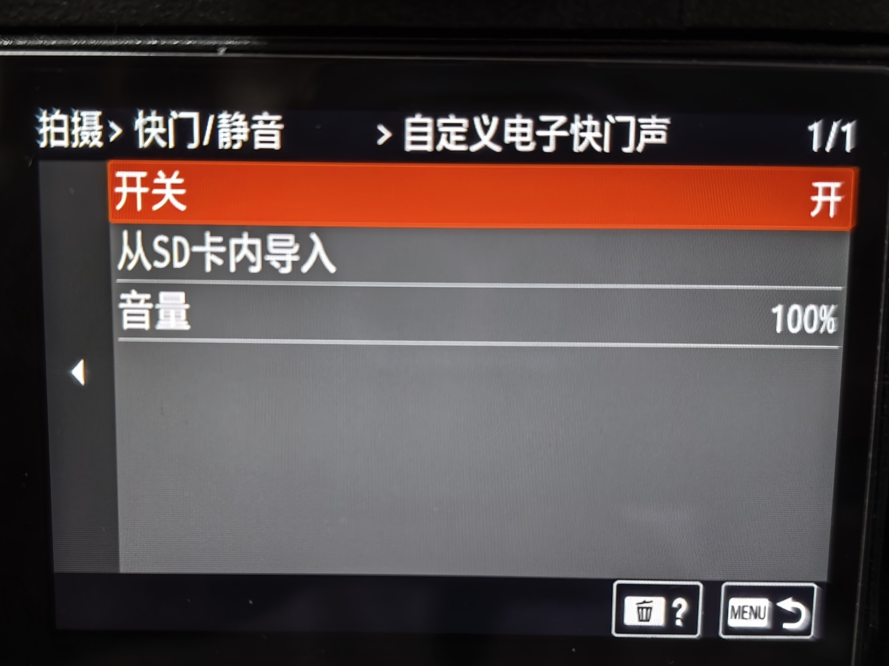
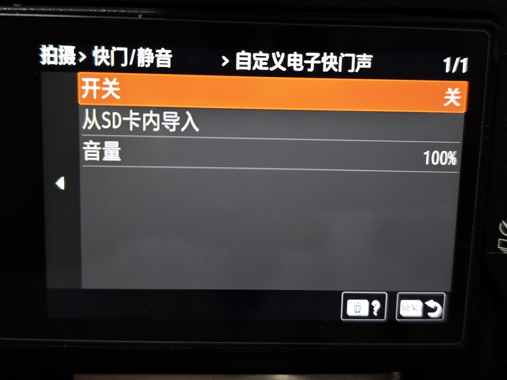
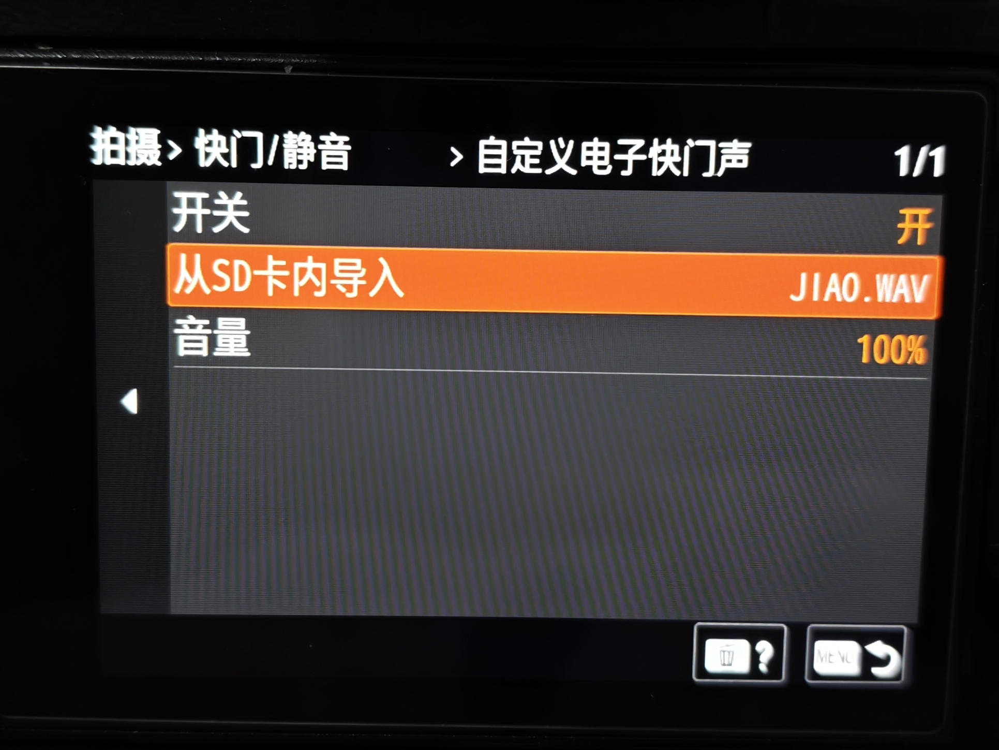
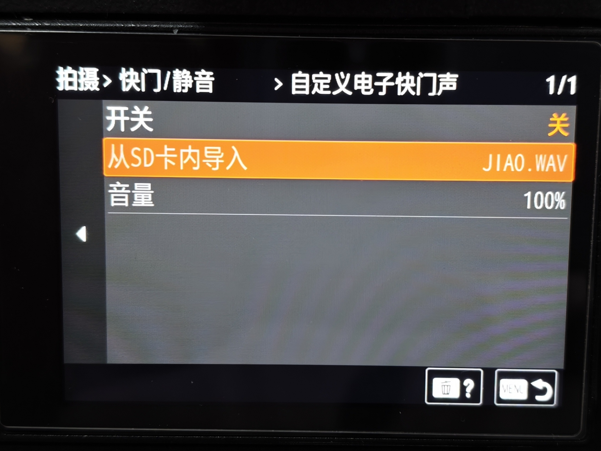

# Custom electronic shutter and focus sounds

[中文](README.md) · [Detailed implementation map](IMPLEMENTATION.md) · [Rebuildable native source](../../native/custom-sounds/README.md)

Working sounds with blank or incorrect merged menu labels: use the [resource-only repair and final-package verification](menu-resource-repair.md). It restores all68 banks while preserving existing LUT and sound program changes.

Adds two independent items under Shooting → Shutter/Silent: custom electronic shutter sound and custom focus sound. The stock electronic shutter has no sound; this implementation adds an exposure event sound rather than replacing a nonexistent stock clip. AF-S / AF-A can use a custom focus clip or the stock default.

**Firmware display numbers are not part of this method.** It does not read or write `updater/dat4`, impose an internal test label, or select compatibility by display version. Exact file hashes and native address/calling contracts establish compatibility.

The public reference recipe requires an AP that already contains the shared menu framework. **It is not a stock-AP recipe and is not automatically included by the existing `build-sd` command.** It reconstructs component files, not a complete installable DAT. Read the root project's backup/update requirements before integrating a complete package.

## Behaviour

- Each menu has enable, import from SD, and volume. Import and volume are disabled when the switch is off; asynchronous completion refreshes both text and availability without an extra key press.
- Select one WAV for each slot from `PRIVATE/SONY/PRO/SOUNDS/`. The filename is shown after a successful durable import. The picker has no date/duration column and uses audio-specific confirmation text.
- WAV bytes, filenames and switches are stored internally; volume has a CRC-protected sidecar. A later boot rebuilds native sound ownership rather than trusting old numeric handles.
- Integer PCM WAV: format 1, mono/stereo, 8/16/24/32 bits, 8–192 kHz, at most 1 MiB and 5 seconds. Invalid RIFF/chunk lengths, unsafe names and compressed/floating-point WAV are rejected.
- Independent 10%–100% levels in 10% steps. 50% is the feature's reference gain; 100% doubles that digital amplitude. The two playback paths receive a matching private CP scalar. This is not a promise of equal perceived loudness for different recordings.
- Silent mode suppresses both sounds. Mechanical/EFCS modes suppress and durably disable the electronic sound. Stock focus-signal settings remain authoritative; AF-C is not customized and MF produces no focus confirmation.
- Focus default/fallback remains available. Exposure and focus have separate slots and event identities. Test them separately using AF-S half-press and MF exposure.

The repository includes user-authorized [YEAH.WAV, DAGOU.WAV and JIAO.WAV examples](../../examples/custom-sounds/README.en.md) for reference and import testing. The example guide covers SD placement, menu steps, audio parameters and SHA-256 checksums. You can also supply your own compatible audio.

## Camera demo photos

These four maintainer-provided photos show the custom electronic shutter sound menu, including the switch, selected WAV filename and volume. All four photos show the electronic shutter sound interface.

| Enabled | Disabled |
|---|---|
|  |  |
|  |  |

## Offline component reconstruction

```powershell
python -m a7m4.custom_sound inspect
python -m a7m4.custom_sound apply --ap local/sound-input/appFw.so --cp local/sound-input/cpapp-b.bin --fs-root local/sound-input/fs --output output/custom-sounds
```

`inspect` lists all 71 required input/output hashes. AP input is `28bd97605c5cb2e0b9edfeec36abf2dec64a46a9895f79b00c7f9356ce2482c3`; CP input is `1c34764fe413d4c0d720d629e323996498305fc29e5c53d2c52d0cca0c0d1504`. Supply the exact local reference AP/CP plus original `fs/lib/libmpr.so` and 68 original `fs/share/app/*.uxc` resources. Filenames and nearby display numbers are not substitutes for these hashes.

All inputs and output hashes are checked before creating a new output directory. Inputs and existing outputs are never overwritten. Output contains `fs/lib/appFw.so`, `fs/lib/libmpr.so`, the resource files, `cp/cpapp-b.bin` and an evidence manifest. Original unchanged bytes are referenced by bounded COPY operations; only changed-byte ADDs are distributed. No complete Sony firmware or camera backups are included. The three reference WAVs are distributed separately in [examples/custom-sounds](../../examples/custom-sounds/README.en.md).

## Source and integration

The [implementation map](IMPLEMENTATION.md) documents the exact menu registrations, ELF relocation changes, controller completion refresh, filesystem transactions, PCM-to-24-kHz f0 conversion, AP/CP leases, restart recovery and gain correction. The [native build](../../native/custom-sounds/README.md) reproduces six modules and their installed sections; post-link corrections are explicit.

A complete firmware build must integrate AP/MPR/all language resources and CP together, preserve unrelated changes and calibration, verify all container checksums/signatures, and synchronize the independent CP NOR through the supported SD update path. Flashing an eMMC CP image alone does not update NOR. The component `cpapp-b.bin` is not a whole partition image. This sound method never chooses a firmware release number; complete-package publication manages that separately.

The full reference profile now enforces AP, CP, MPR and every required horizontal/vertical bank, including text records. After integration, extract the filesystem from the **final package** and run `python -m a7m4.custom_sound verify-resources --fs-root local/final-package-fs`. Correct intermediate files alone do not prove that the final package contains them.

## Validation

The maintainer's existing single-camera implementation received successful custom-sound, matching-level and repeated-restart feedback, followed by user acceptance of the requested functionality. The published reference files were checked offline; they have no separate new hardware acceptance claim.

This publication rechecks 71 complete reconstructed file hashes, six source-built modules and their installed sections, 32 C core checks, and Python input/output guard tests. See [validation evidence](../../docs/custom-sounds-validation.json). No camera operation or new installable package was performed. Other baselines and combinations still require native replay, full-package audit and hardware testing, including immediate startup, repeated OFF/ON, silent/mechanical policies, real bursts, photo writes and clean shutdown.
