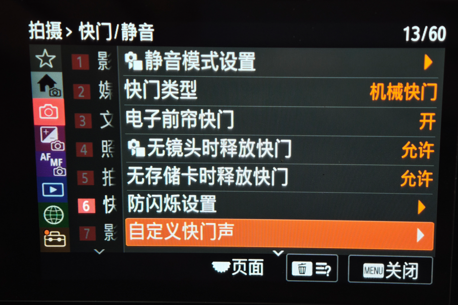
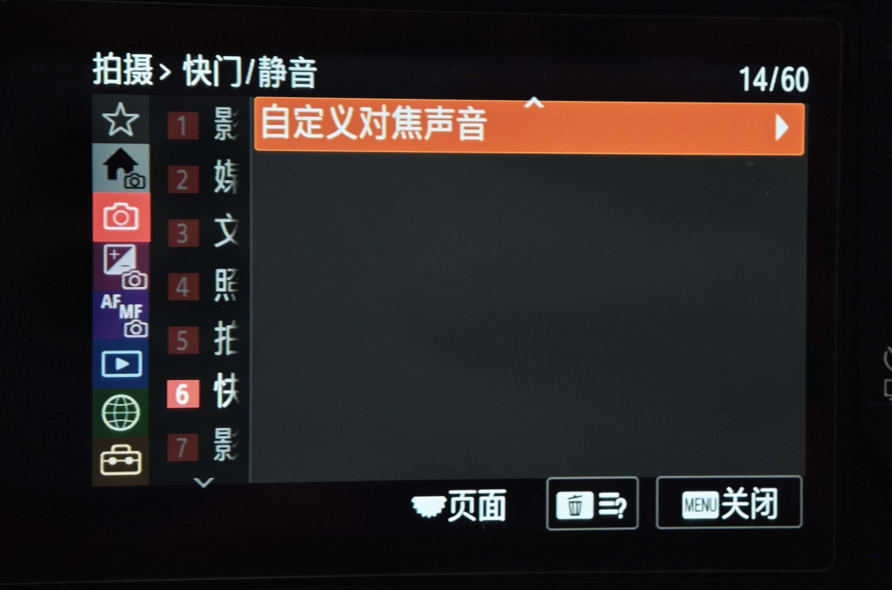
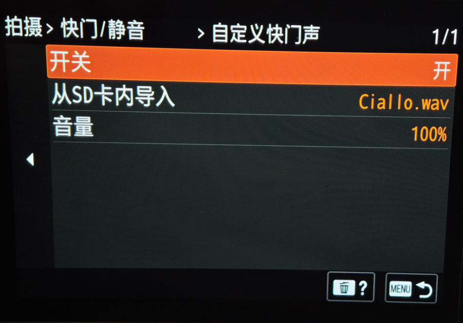
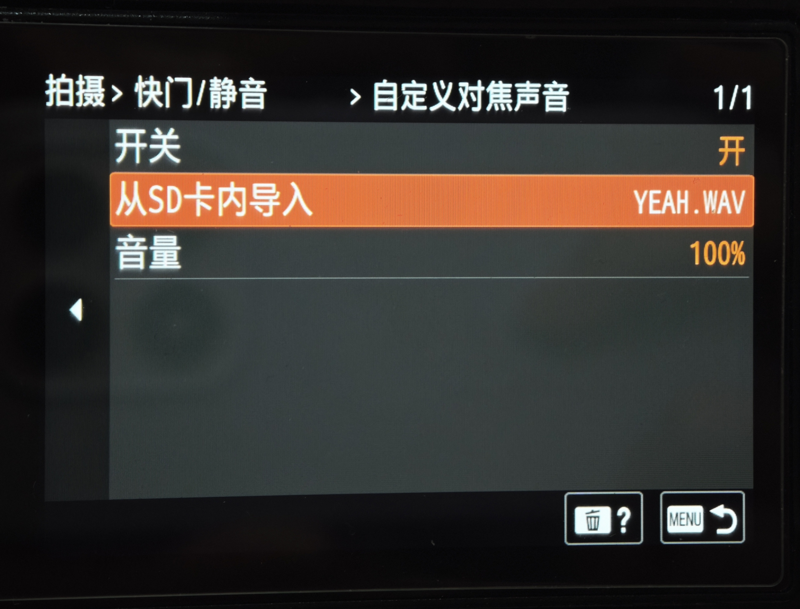
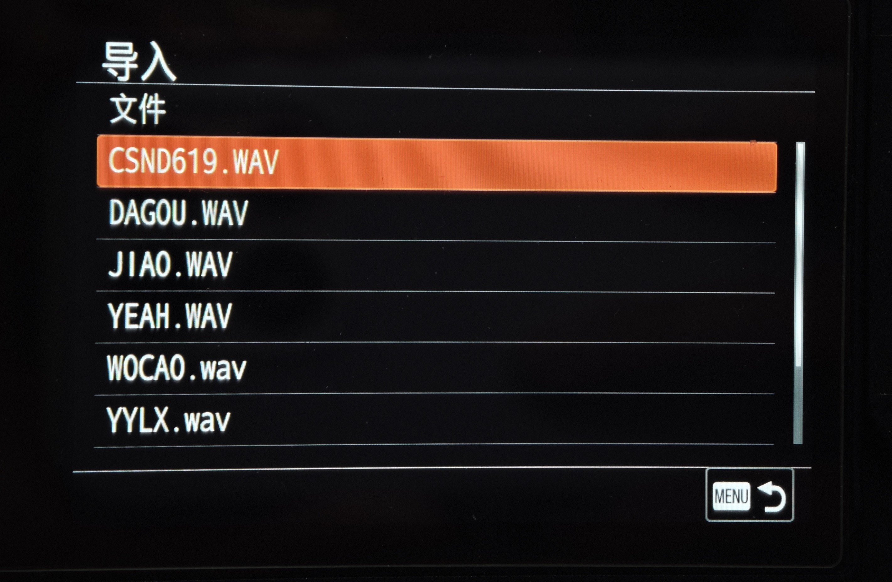

# 自定义快门声与自定义对焦声

[English](README.en.md) · [源码、地址与修改方法](IMPLEMENTATION.md) · [原生源码与构建](../../native/custom-sounds/README.md)

在“拍摄 → 快门/静音”中增加“自定义快门声”和“自定义对焦声音”。**机械快门、电子前帘和电子快门都可播放导入的快门声**，三种方式共用快门声的开关、音频和音量。切换快门类型后保留声音设置。机械幕帘自身的声音仍会存在，自定义声音由扬声器叠加播放。

AF-S / AF-A 合焦可使用单独的音频或恢复原厂默认提示。两类声音分别保存开关、WAV 和音量，静音模式同时控制两类自定义播放。

对焦声与快门声按**最后触发优先**相互抢占：播放快门声时再次合焦会转为对焦声，播放对焦声时拍照会转为快门声。连拍时新拍摄重新触发声音；停止操作后，最后一段自然播完，较早的声音不再排队补播。

## 文件放置与操作

将 WAV 放在所用 SD 卡根目录下的 **`PRIVATE/M4ROOT/GENERAL/SOUNDS/`**：

```text
PRIVATE/
└─ M4ROOT/
   └─ GENERAL/
      └─ SOUNDS/
         ├─ shutter.wav
         └─ focus.wav
```

1. 进入“拍摄 → 快门/静音 → 自定义快门声”，将开关设为“开”。
2. 选择“从 SD 卡内导入”，选择存储卡和 WAV 文件，确认导入。
3. 设置音量。机械快门、电子前帘和电子快门使用同一份快门声。
4. 如需合焦音，进入“自定义对焦声音”，从同一目录单独选择 WAV。

已导入的完整音频与文件名保存在机内，关机重启后恢复，不要求原 SD 卡一直留在机内。已有机内声音可继续使用；需要重新导入的 WAV 请放到上述目录。

| 项目 | 行为 |
|---|---|
| 快门声 | 机械／电子前帘／电子快门均可触发；切换快门类型不关闭声音开关 |
| 对焦声 | AF-S / AF-A 合焦使用独立音频，可选择“默认”；AF-C 和 MF 沿用原有规则 |
| 音量 | 两个声音槽各自设置 10%–100%，每档 10%；50% 为基准增益，100% 为基准的两倍数字幅度 |
| 关闭开关 | 对应的导入与音量行灰显；关闭一类声音不影响另一类 |
| 静音模式 | 两个自定义声音均不播放；解除后按原有选择恢复 |
| 文件列表 | 显示 WAV 文件名和橙色选框，使用音频专用确认文字 |

建议使用短促的整数 PCM WAV：格式 1、单／双声道、8/16/24/32 位、8–192 kHz，单文件最多 1 MiB、最长 5 秒。压缩或浮点 WAV、损坏的 RIFF/chunk 和不安全文件名会被拒绝。可下载维护者授权公开的 [YEAH.WAV、DAGOU.WAV 和 JIAO.WAV 示例](../../examples/custom-sounds/README.md)。

原厂“音频信号／对焦提示音”关闭时，自定义对焦声也不出声。对焦声由相机实际的合焦确认事件触发；拍照与合焦相继发生时，播放最后触发的声音。

## 实机演示照片

**菜单位置：机械快门、电子前帘开启时也可使用自定义快门声**

| 自定义快门声 | 自定义对焦声音 |
|---|---|
|  |  |

**分别设置开关、音频和音量**

| 自定义快门声：Ciallo.wav，100% | 自定义对焦声音：YEAH.WAV，100% |
|---|---|
|  |  |

**选择“从 SD 卡内导入”浏览 WAV 文件**



## 生成修改后的组件

本仓库分发原创源码和修改配方，不附带完整索尼固件。参考 AP 已包含共享菜单框架，**不能用原厂 AP 直接替代**；兼容性由每个文件的完整 SHA-256 和地址布局确定。

```powershell
python -m a7m4.custom_sound inspect
python -m a7m4.custom_sound apply --ap local/sound-input/appFw.so --cp local/sound-input/cpapp-b.bin --fs-root local/sound-input/fs --output output/custom-sounds
```

按 `inspect` 提供精确的 AP、CP、`fs/lib/libmpr.so` 及 68 个横竖屏语言资源。输出包括修改后的 AP、MPR、语言资源、CP 和校验清单，已包含机械快门支持、当前菜单名和新声音目录。输入与已有输出不会被覆盖。

上述命令重建其列明的基础声音布局。当前 LUT／纵横比组合布局的双向抢占在完整 CP 上单独应用：

```powershell
python -m a7m4.custom_sound_handoff --input local/integrated/cpapp-b.bin --output output/cpapp-b.handoff.bin
```

输入／输出摘要见[交接配方](../../a7m4/profiles/custom-sound-handoff.json)。本工具只接受指定的组合 CP；基础声音配方的 CP 不能直接替代该输入。源码与从源码重建安装段的命令见[交接模块](../../native/custom-sounds/handoff/README.md)。

菜单空白或错名时可使用[文字资源独立修复](menu-resource-repair.md)。完整固件集成后，从最终包提取文件系统，再执行：

```powershell
python -m a7m4.custom_sound verify-resources --fs-root local/final-package-fs
```

## 源码与完整固件集成

[实现方法](IMPLEMENTATION.md)列出快门策略、目录拼接、菜单资源 ID、持久化、AP/CP 资源交接与音量的具体修改位置。[原生构建说明](../../native/custom-sounds/README.md)包含六模块编译、保持地址的后链接修改及当前策略源码的生成方式。

完整固件需要将 AP、MPR、全部语言资源和 CP 一起集成，重算容器与分区校验及签名，并通过支持的 SD 更新链同步 CP 的独立 NOR。组件 `cpapp-b.bin` 不是可直接刷入的整个分区。其他基线需重新核对地址、调用合同、内存归属和实际运行行为。

SD JSON／多槽 LUT 与声音共享 AP 注册器、GUI 生命周期、语言资源和 CP 启动／分派链，组合时遵守 [LUT 集成规则](../08-custom-lut/INTEGRATION.md)。不要以较早的独立 AP 或整套资源覆盖已经合入其他功能的组件。
