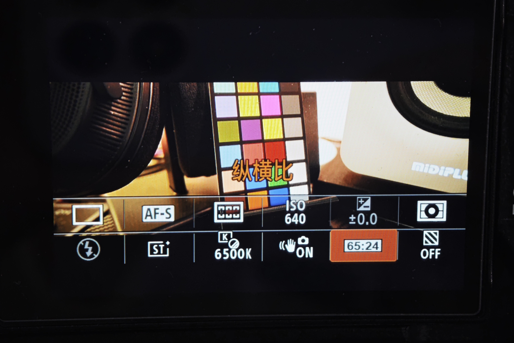
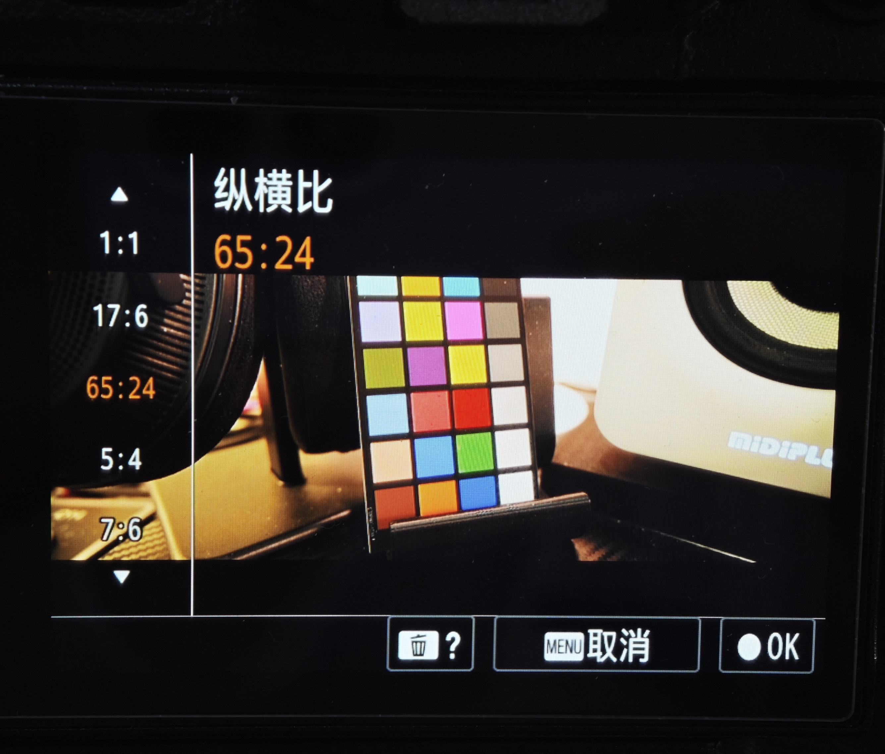

# 自定义纵横比：17:6、65:24、5:4、7:6

> 组合主线更新：[6.62 与 LUT／声音的合并实现](../../native/combined-662/README.md)另行发布 CP 源码和精确组件合并配方；修复布局、注册链和文字 ID 冲突，组合实机待验。下文 T22 地址、文件哈希和验收仍仅代表原独立构建。

[English](README.en.md) · [具体修改位置与实现方法](IMPLEMENTATION.md) · [返回方法目录](../../README.md)

在 Sony A7 IV（ILCE-7M4）原有“纵横比”功能中新增 **17:6、65:24、5:4、7:6**，保留原厂 3:2、4:3、16:9、1:1。通过原有菜单或 Fn 快捷菜单选择，支持对应文字、Fn 图标和实时取景遮罩。维护者已确认本次 **6.63 T22** 功能构建的横、竖屏预览正常。

本页介绍最终功能、实现方法及实机效果。完整固件需基于兼容的程序与资源统一集成；本页不提供独立安装命令或完整固件下载。更新要求见[主项目说明](../../README.md)。

准备自行实现或移植时，请阅读 [IMPLEMENTATION.md](IMPLEMENTATION.md)：其中列出具体文件与地址、菜单/资源 ID、私有状态、AP→CP 传递、JPEG/HEIF 裁切、RAW 边界，以及三类预览页面的遮罩和横竖屏处理。[参考清单](reference-layout.json)提供最终文件 SHA-256 和已核对的预览跳转。

## 功能结果

| 项目 | 修改后的行为 |
| --- | --- |
| 新增比例 | 17:6、65:24、5:4、7:6，与四个原厂比例并列 |
| JPEG / HEIF | 按所选比例生成居中裁切成片，尺寸遵循原编码器的像素对齐要求 |
| RAW | 保持原始幅面；RAW+JPEG 中的 JPEG 使用所选裁切比例 |
| 比例文字与 Fn 图标 | 显示当前自定义比例 |
| 纵横比选择页 | 预览随当前高亮的比例变化；确认后应用，取消返回已保存的选择 |
| Fn 快捷菜单与拍摄页 | 显示所选比例对应的取景遮罩 |
| 横竖屏切换 | 遮罩按屏幕方向和显示映射转换，支持横、竖屏预览 |

## 关于预览遮罩

**自定义纵横比的实时取景通过遮罩标示裁切范围。进入部分参数设置页面时，预览可能暂时恢复为原始 3:2 画面；返回拍摄界面后，会恢复所选比例的遮罩。这只影响设置页面中的预览显示，JPEG/HEIF 成片仍按所选比例裁切，RAW 保持原始幅面。**

预览遮罩和照片裁切属于两条处理路径：遮罩用于构图，JPEG/HEIF 输出实际按目标比例裁切，并非把黑边写入照片。

## 使用方式

1. 从菜单进入“纵横比”，或通过 Fn 快捷菜单打开该项目。
2. 在原有比例之后选择 17:6、65:24、5:4 或 7:6，按确认应用。
3. 返回拍摄界面，依据遮罩内的区域构图；旋转相机时，遮罩随显示方向调整。
4. 使用 JPEG / HEIF 保存裁切后的照片；需要保留原始幅面时，同时保存 RAW。

## 最终实现方法

| 部分 | 实现内容 |
| --- | --- |
| 菜单与资源 | 在原纵横比选项表中加入四项，并提供对应文字、列表显示和 Fn 图标资源 |
| 选择状态 | 区分当前高亮与已确认比例，分别供浏览预览和拍摄状态使用，保持确认、取消及保存语义 |
| 照片输出 | 将目标比例传递到 JPEG/HEIF 的居中裁切路径，按各图像尺寸及编码对齐计算输出；RAW 保持原始几何 |
| 预览绘制 | 根据实际取景区域、像素纵横比及所选比例计算两侧遮罩，在拍摄页、Fn 页和纵横比选择页绘制 |
| 方向处理 | 先在物理取景坐标中计算遮罩，再按同一份原生状态快照的方向与显示映射转换完整矩形；页面创建、刷新与旋转均使用对应结果 |

居中裁切以输入宽高 `W × H` 和目标比例 `N:D` 为基础：输入较宽时保留高度并裁去左右，输入较高时保留宽度并裁去上下；最终像素尺寸按编码器要求对齐。预览计算还需纳入显示像素纵横比，屏幕旋转则同时转换矩形位置与宽高。

本方法涉及 AP、成片裁切路径和界面资源的配套集成。移植到其他固件时，应以实际源文件哈希、地址布局与调用关系确定兼容性；显示版本号本身不能作为补丁匹配依据。

## 实机效果

以下两张照片由维护者提供并授权公开，均展示 **65:24**。公开副本移除了定位等元数据，压缩图像数据及解码像素保持原样。

### Fn 快捷菜单

### 纵横比选择页

## 验证结果

维护者已确认比例文字、Fn 图标与拍照尺寸正确，并在本次 6.63 T22 测试后确认“横竖屏都没问题”。JPEG 裁切与 RAW 原始几何已有样片核对；上述照片展示 65:24 的界面效果。HEIF 已纳入裁切实现，本页未提供独立 HEIF 实拍样片测量。

本次选择页实现通过 336 项原生创建/旋转与遮罩清除回放、3,475 项绘制检查、3,968 项调用约定检查；最终安装包通过签名、739,727 个数据块、分区 CRC 和目标文件核验。实机结论来自维护者的单台 A7M4，不代表任意机型、固件组合或全部输出设备均已验证。

图片身份见 [assets/manifest.json](assets/manifest.json)；图片授权说明见[第三方说明](../../THIRD_PARTY_NOTICES.md)。
