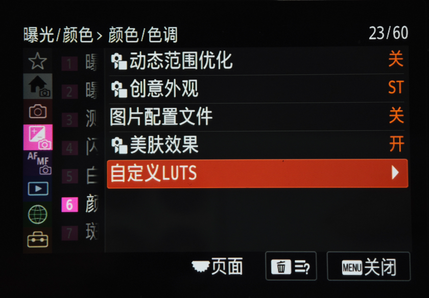
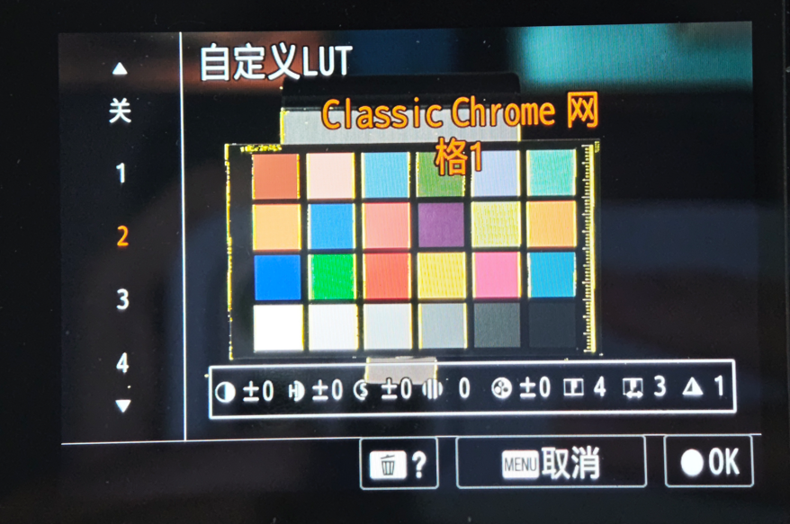
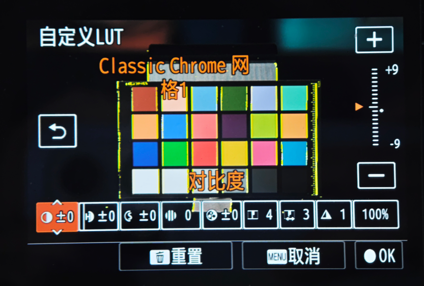
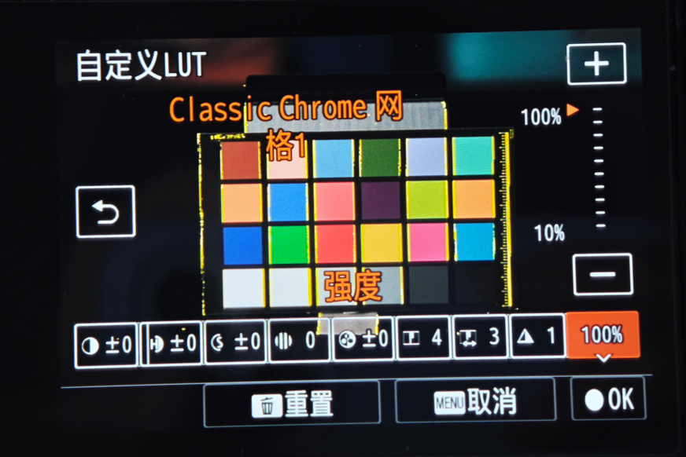
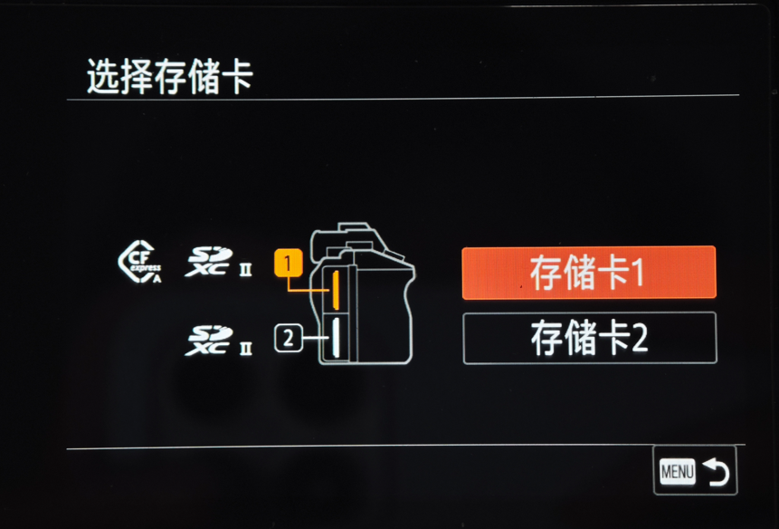
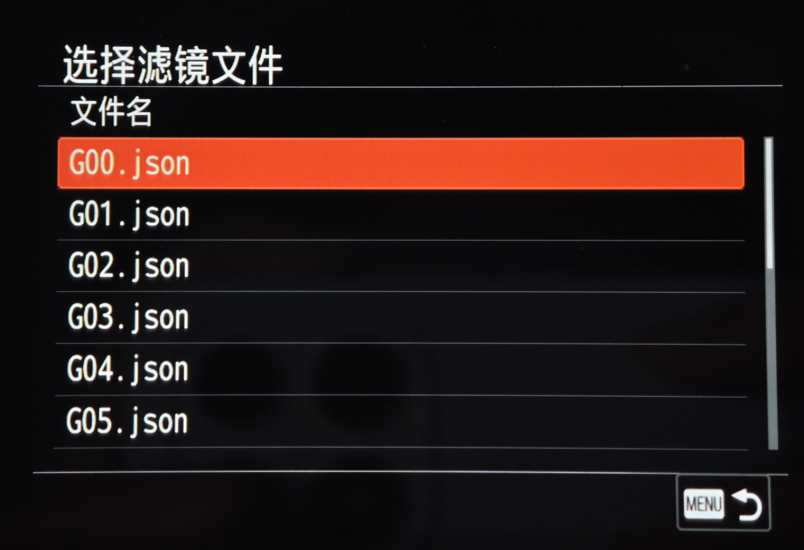

# Custom LUTs: SD import and independent adjustments

[中文](README.md) · [Implementation](IMPLEMENTATION.md) · [JSON contract](FORMAT.md) · [Integration](INTEGRATION.md)

Adds Custom LUTS under Exposure/Color → Color/Tone on the Sony A7 IV (ILCE-7M4).

- Import individually converted **JSON LUT files from an SD card**, one file per look.
- Each look has **eight native adjustments plus one strength control**. The preview shows eight values; the detailed editor shows all nine.
- The **first use after powering on takes approximately one second to load** with timing varying by file, card and camera state.
- **16 custom slots**, replaceable whenever needed. Imported looks and per-slot settings persist internally, so later use does not require the original SD file.

## Operation

Put converted `.json` files in `PRIVATE/M4ROOT/GENERAL/LUT/`. Open Custom LUTS, enter import, choose the card and file, and follow the on-camera import/replacement flow. Select a look, press Right for the detailed editor, select a control with Left/Right, and change it with Up/Down or the on-screen controls. Confirm saves; Cancel restores the previous selection/settings. Reset restores the look's defaults and 100% strength. The deletion page supports removing the current look or clearing all looks.

Contrast, highlights, shadows and saturation range from −9 to +9; fade, sharpness and clarity from 0 to 9; sharpness range from 1 to 5. Strength runs from 10% to 100% in 10% steps. Lower strength approaches **fixed factory ST defaults**, independently of the user's current ST adjustments.

Each slot independently retains its eight adjustments and strength. Ordinary `.cube` or DCP files must first be converted to the native JSON contract; renaming a file is not conversion. Format validity does not establish color-match quality.

## Camera photographs

Supplied and authorized by the maintainer. Displayed look names are examples, not distributed presets or claims of commercial-preset equivalence.

| Menu entry | Preview |
| --- | --- |
|  |  |
| Nine-control editor | Strength |
|  |  |
| Card selection | JSON selection |
|  |  |

## Implementation resources

Includes implementation and modification locations, component identities, a [standalone atomic cache core](../../native/custom-lut/README.md), and camera UI photographs. It does not distribute complete manufacturer programs, color tables or firmware packages, and does not add a complete one-command firmware builder.

Follow the [integration notes](INTEGRATION.md) when combining methods.
