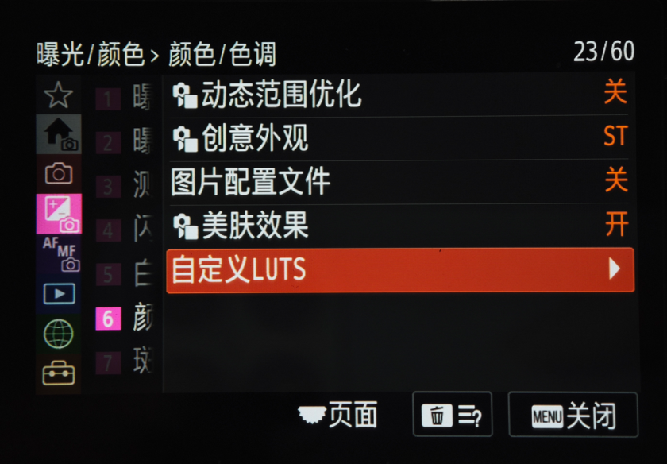
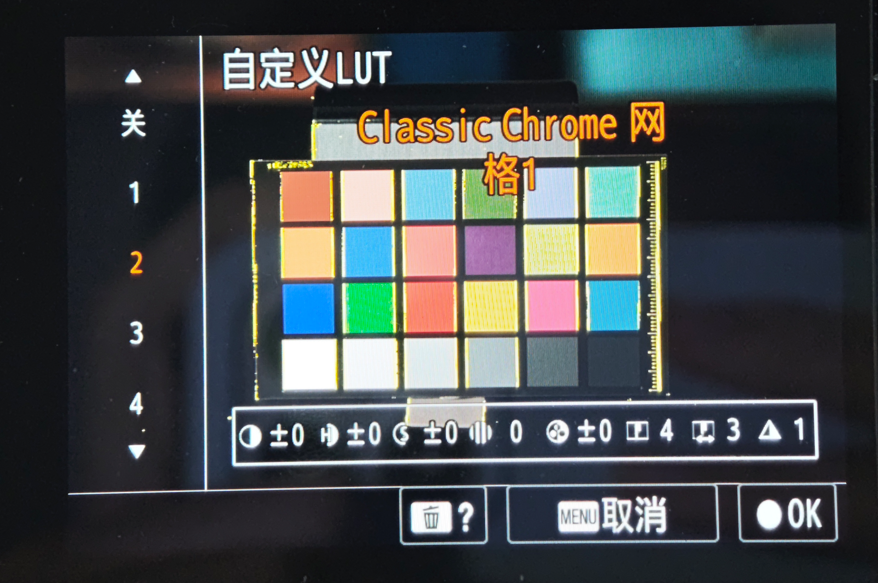
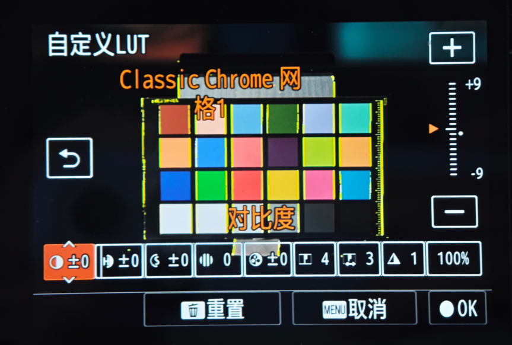
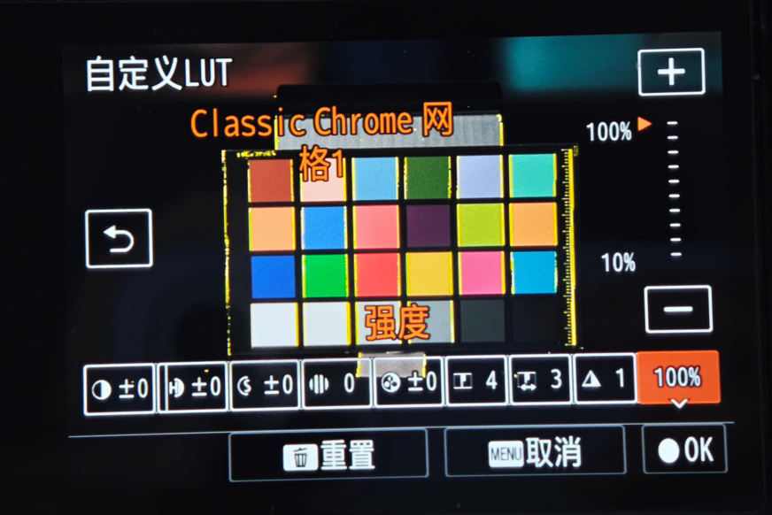
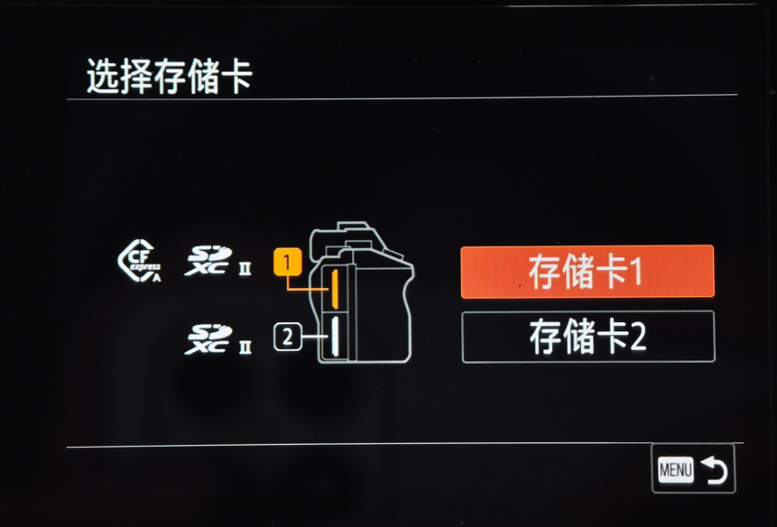
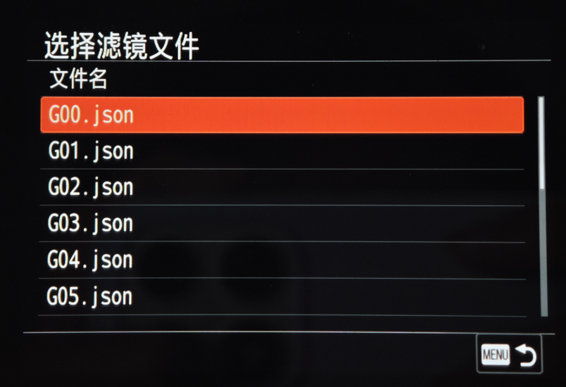

# Custom LUTs: SD import and independent adjustments

[中文](README.md) · [Implementation](IMPLEMENTATION.md) · [JSON contract](FORMAT.md) · [Integration](INTEGRATION.md) · [Training results](../../docs/custom-lut-training/README.en.md) · [Agent training method](../../docs/custom-lut-training/AGENT_TRAINING.en.md)

Adds Custom LUTS under Exposure/Color → Color/Tone on the Sony A7 IV (ILCE-7M4).

- Import individually converted **JSON LUT files from an SD card**, one file per look.
- Each look has **eight native adjustments plus one strength control**. The preview shows eight values; the detailed editor shows all nine.
- The **first use after powering on takes approximately one second to load** with timing varying by file, card and camera state.
- **16 custom slots**, replaceable whenever needed. Imported looks and per-slot settings persist internally, so later use does not require the original SD file.

## Operation

Put converted `.json` files in `PRIVATE/M4ROOT/GENERAL/LUT/`. Open Custom LUTS, enter import, choose the card and file, and follow the on-camera import/replacement flow. Select a look using the keys or by touching the left number column, press Right for the detailed editor, select a control with Left/Right, and change it with Up/Down or the on-screen controls. Confirm saves; Cancel restores the previous selection/settings. Reset restores the look's defaults and 100% strength. The deletion page supports removing the current look or clearing all looks.

Contrast, highlights, shadows and saturation range from −9 to +9; fade, sharpness and clarity from 0 to 9; sharpness range from 1 to 5. Strength runs from 10% to 100% in 10% steps. Lower strength approaches **fixed factory ST defaults**, independently of the user's current ST adjustments.

Each slot independently retains its eight adjustments and strength. Ordinary `.cube` or DCP files must first be converted to the native JSON contract; renaming a file is not conversion. Format validity does not establish color-match quality.

Compiled base results persist internally for reuse after power-on. All eight adjustments and strength remain available and independently saved.

## File size and count requirements

| Item | Current requirement |
| --- | --- |
| Each look file | A valid, nonempty UTF-8 native JSON, **at most 128 KiB (131,072 bytes, inclusive)**; measured per extracted file, not by archive size |
| SD import directory | **At most 256 directory entries** in `PRIVATE/M4ROOT/GENERAL/LUT/`; non-JSON files and subdirectories count too. Subdirectories are not scanned recursively |
| Stored in camera | **16 custom-look slots**, replaceable or deletable; Off does not occupy a look slot |
| Filename | **At most 63 UTF-8 bytes including `.json`**; multibyte names are limited by bytes, not character count. Extension matching is case-insensitive |

Extract the look package first and place the desired JSON files directly in that directory. Exceeding the entry limit **fails the scan rather than showing only the first 256 entries**. Add files in batches and keep archives, documentation and unnecessary subdirectories elsewhere. The camera still stores at most 16 looks at once; the card can hold more import candidates.

An oversized or invalid JSON can also fail the current list scan/import. If a file is missing, check its name, native format and location. These are separate limits for each file, the designated import directory and camera slots—not a limit on the total files on the SD card.

## Camera photographs

Supplied and authorized by the maintainer. Displayed look names are examples, not distributed presets or claims of commercial-preset equivalence.

| Menu entry | Preview |
| --- | --- |
|  |  |
| Nine-control editor | Strength |
|  |  |
| Card selection | JSON selection |
|  |  |

## Implementation resources

Includes implementation and modification locations, component identities, a [CP atomic cache core](../../native/custom-lut/README.md), an [AP compiled-result cache](../../native/persistent-cache/README.md), and camera UI photographs. It does not distribute complete manufacturer programs, color tables or firmware packages, and does not add a complete one-command firmware builder.

Follow the [integration notes](INTEGRATION.md) when combining methods.

## Touch selection

Touch the left number column to select Off or slots 01–16; the look name and preview follow the selection. OK saves, while MENU cancels back to the committed choice. Empty slots remain selectable for import. The maintainer confirmed the reported number-column touch issue is resolved.

See the authored source and exact [menu UI components](../../native/menu-ui-fixes/README.md) and the [integration order](INTEGRATION.md).
