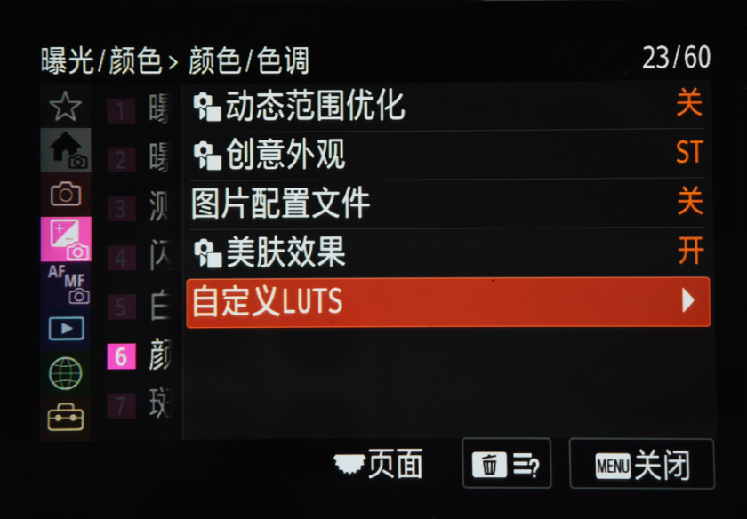
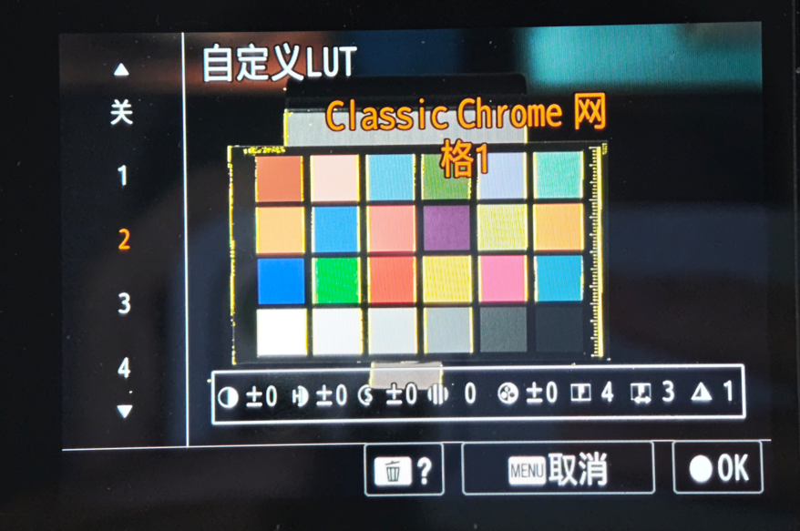
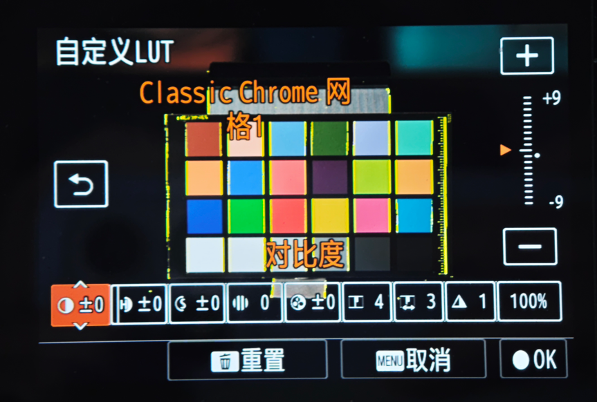
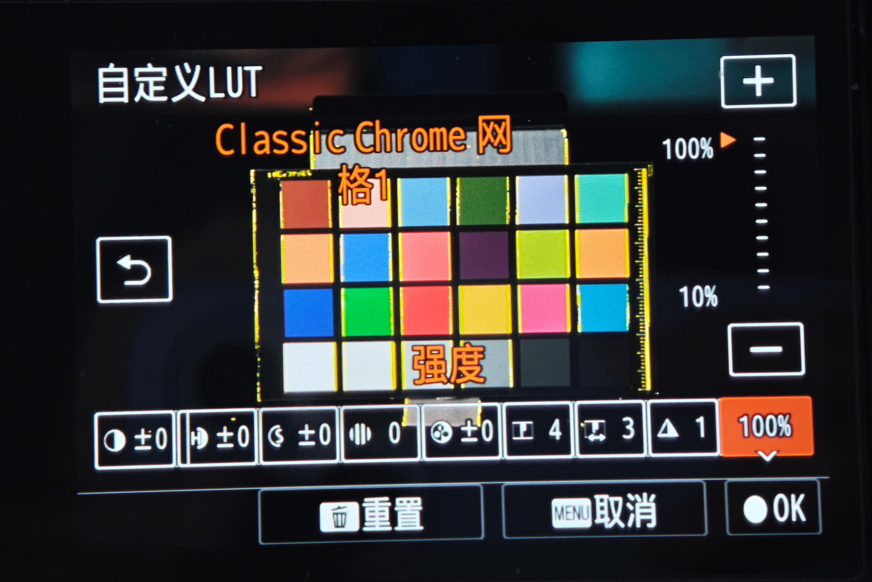
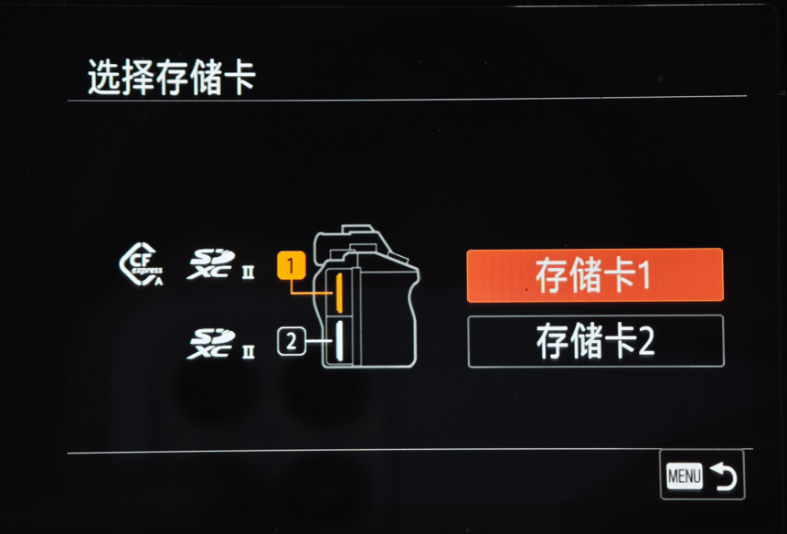
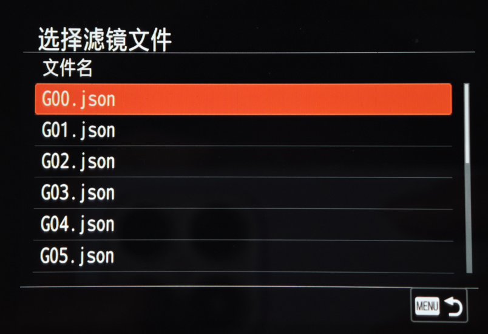

# 自定义 LUT：SD 卡导入与独立微调

[English](README.en.md) · [修改位置与实现](IMPLEMENTATION.md) · [JSON 格式](FORMAT.md) · [与其他方法组合](INTEGRATION.md) · [训练结果](../../docs/custom-lut-training/README.md) · [Agent 训练方法](../../docs/custom-lut-training/AGENT_TRAINING.md)

运行时代码精简及当前组件身份见[精简方法](RUNTIME-CLEANUP.md)。维护者已测试精简后的组合固件，反馈运行正常、未发现问题。

在 Sony A7 IV（ILCE-7M4）的“曝光/颜色 → 颜色/色调”中增加“自定义 LUTS”。每个滤镜保存独立参数，可直接在机内预览、调整、替换和删除。

- **从 SD 卡单独导入**经过转换的 JSON 格式 LUT 文件，每个滤镜一个文件。
- **每个滤镜有八项自带参数和一项强度参数**，预览页显示八项，详细调节页显示九项。
- **每次开机后初次使用约需 1 秒载入**。具体时间随文件、卡和相机状态变化。
- **共 16 个自定义槽位，可随时替换**。已导入的滤镜和各槽参数保存在机内，之后使用不依赖 SD 卡原文件。

## 使用

1. 将转换好的 `.json` 文件放到 SD 卡的 `PRIVATE/M4ROOT/GENERAL/LUT/` 目录。
2. 打开“自定义 LUTS”，进入导入，选择存储卡和滤镜文件，按界面提示导入或替换槽位。
3. 用实体按键或触摸左侧编号栏选择滤镜预览，按右键进入详细调节；左右选择项目，上下调整数值，也可使用屏幕上的调节控件。
4. 确认后保存；取消返回之前的选择与参数。“重置”恢复该滤镜的默认参数和 100% 强度。删除页可删除当前滤镜或清空全部滤镜。

普通 `.cube`、DCP 等文件需要先转换为本项目的原生参数 JSON；改扩展名不能完成转换。JSON 格式与色彩匹配质量是两件事，参见[格式与转换边界](FORMAT.md)。

基础编译结果保存在机内，开机可直接复用；八项微调与强度照常调整、独立保存。

## 文件大小与数量要求

| 项目 | 当前要求 |
| --- | --- |
| 单个滤镜文件 | 有效、非空的 UTF-8 原生 JSON，**最大 128 KiB（131,072 字节，含等号）**；按解压后单个文件的实际大小计算 |
| SD 卡导入目录 | `PRIVATE/M4ROOT/GENERAL/LUT/` 内**最多 256 个目录项**；非 JSON 文件和子文件夹也计数，不递归扫描子文件夹 |
| 机内保存数量 | **16 个自定义滤镜槽位**，可替换或删除；“关”不占滤镜槽位 |
| 文件名 | 含 `.json` 扩展名最多 **63 个 UTF-8 字节**；中文等多字节字符不能按字符个数计限，扩展名不区分大小写 |

滤镜包应先解压，将需要的 JSON 直接放入上述目录。文件数量超过限制时扫描会失败，**不是只显示前 256 项**。请分批放入文件，并把压缩包、说明文档及多余子文件夹移出该目录；机内同时保存的上限仍是16款，存储卡上可以准备更多候选。

超大的或无效的 JSON 也可能导致本次列表扫描／导入失败。文件未显示时先核对文件名、格式和放置目录。以上限制针对单个文件、指定导入目录及机内槽位，不是整张 SD 卡的总文件数量限制。

## 九项调节

| 项目 | 范围 |
| --- | --- |
| 对比度、高光、阴影、饱和度 | −9～+9 |
| 褪色、锐度、清晰度 | 0～9 |
| 锐度范围 | 1～5 |
| 强度 | 10%～100%，每档 10% |

降低强度时，效果逐渐接近**固定的原厂 ST 默认效果**，不受当前 ST 微调值影响。每个槽位独立保存八项微调与强度。

## 实机界面

照片由维护者提供。照片中的滤镜名称用于演示，不代表本仓库分发该滤镜数据或承诺与某款商业预设等效。

| 菜单入口 | 预览与八项参数 |
| --- | --- |
|  |  |
| 九项详细调节 | 强度调节 |
|  |  |
| 选择存储卡 | 选择 JSON 文件 |
|  |  |

## 实现资料

本方法提供实现说明、具体修改位置、组件身份与范围清单、可独立编译的[CP 缓存核心](../../native/custom-lut/README.md)、[AP 编译结果缓存](../../native/persistent-cache/README.md)，以及实机界面照片。完整 AP/CP、厂商颜色数据和固件安装包不在本方法中分发；这里没有新增一键构建完整固件的命令。

涉及其他功能时先读[组合说明](INTEGRATION.md)。不要用较早的整份 AP/CP 覆盖已包含新功能的文件。

## 触摸编号栏

左侧编号栏可触摸选择“关”或01–16，滤镜名称与预览随选择更新。触摸选择后按OK保存，MENU取消返回原选择；未导入槽位仍可选择用于导入。维护者已实机确认编号栏触摸问题修复。

实现与精确组件构建见[菜单UI组件](../../native/menu-ui-fixes/README.md)，组合顺序见[集成说明](INTEGRATION.md)。
