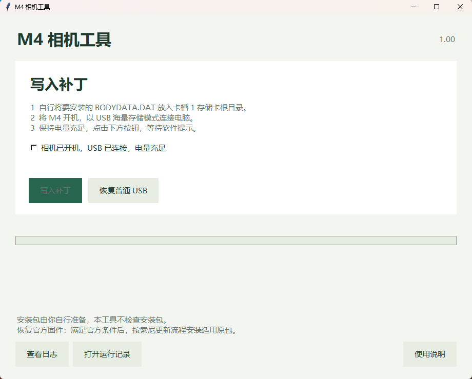
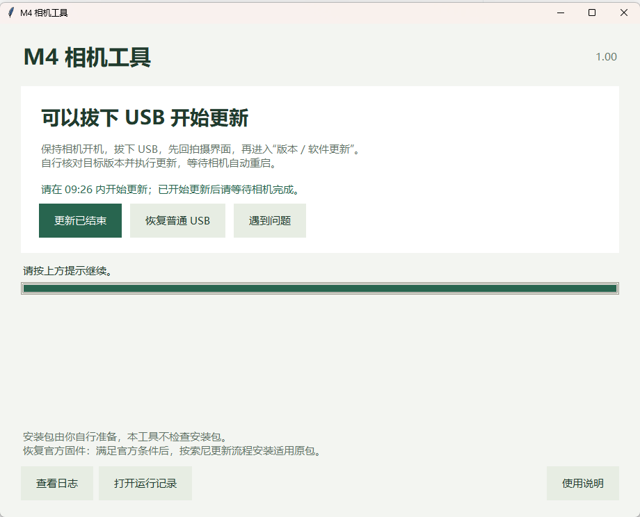
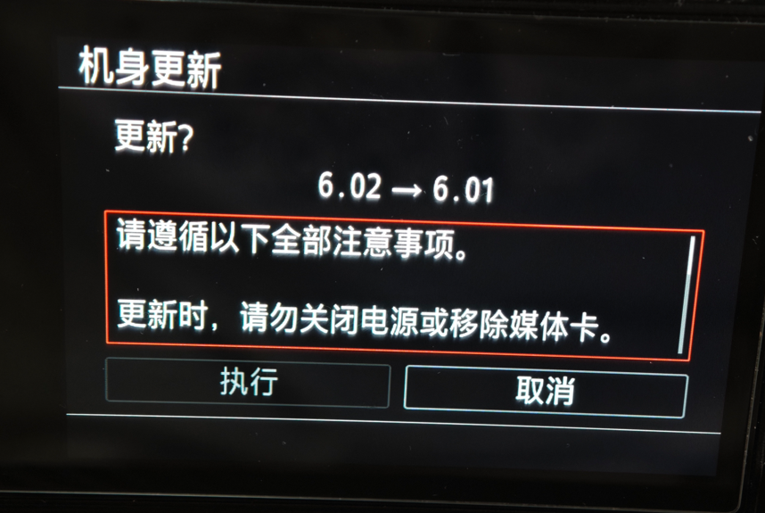
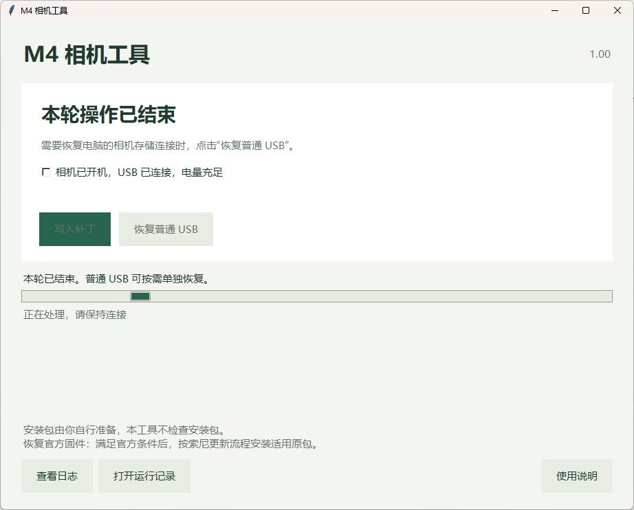
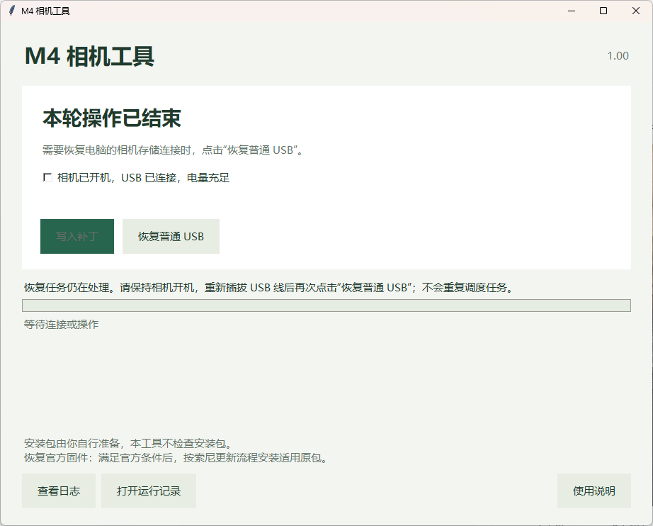

# Install firmware without Fastboot

[中文](README.md) · [Patch locations](IMPLEMENTATION.md) · [M4 Camera Tool guide](TOOL-1.0.0.md)

> [!IMPORTANT]
> **This firmware supports mainland-China-market and Hong Kong-market Sony ILCE-7M4 (A7 IV / A7M4) cameras, running official Sony firmware V6.02 before installation.**
>
> **Successful flashing has been reported on multiple Hong Kong-market A7M4 cameras. Other regional variants and other firmware versions have not yet been tested on hardware and remain outside the current supported scope.**

A normal USB data cable prepares the Sony ILCE-7M4 updater; the camera then installs `BODYDATA.DAT` from its SD card. This route needs no Multi-port flashing cable, boot bridge or Fastboot session. The camera must boot normally and support USB mass-storage mode. It is not a recovery route for an unbootable camera.

Download the firmware package for your camera and **M4 Camera Tool** from the project's [Releases](https://github.com/Erlla/sony-a7m4-custom-firmware/releases).

The tool writes the p1 updater partition. Preserve your own backups, use an original battery, meet the updater's charge requirement and maintain stable power. The automatic p1 backup is not a complete eMMC, calibration or CP NOR backup.

## Use

### 1. Put the firmware on the card

Download `BODYDATA.DAT` from the Release and copy it directly to the **root of the card in slot 1**, outside any subfolder. The DAT does not need extraction. Download and extract the tool separately; it does not read, validate or copy the card's installation package.

### 2. Open the tool and write the patch

Extract the complete tool package to a short path, such as `D:\M4`. Turn on the camera, connect it to the computer in **USB mass-storage mode**, and open `M4相机工具.exe`.

**Administrator privileges are required: approve the Windows administrator prompt. First use installs the required drivers and may take some time; wait for it to finish.**

Figure 1 shows the initial screen. Confirm readiness, tick **相机已开机，USB 已连接，电量充足** (camera on, USB connected, battery sufficiently charged), then click **写入补丁** (Write patch) and wait.

The tool backs up the updater, checks compatibility, patches if necessary and verifies an independent full readback. If prompted during preparation, keep the camera on, unplug/replug USB and continue. Do not start the camera update yet.

### 3. Unplug when instructed and update on the camera

Wait until **可以拔下 USB 开始更新** (You can unplug USB and start the update) appears as in Figure 2. Keep the camera on, unplug USB, return to shooting, then open **Version / Software Update** on the camera.

Check the target version on the camera's update screen, shown in Figure 3. Select **执行** (Execute), then wait for installation and the automatic restart. The photo shows **6.02 → custom 6.01** as an example; 6.01 is this project's custom firmware label.

The menu window lasts approximately **ten minutes**; start within the remaining time shown by the tool. **Once installation starts, do not turn off the camera or remove the card, even if the computer countdown expires.**

### 4. Reconnect USB after installation

After installation and a normal boot, check the version, shooting, saving and playback. Reconnect the camera to the computer and click **更新已结束** (Update finished) on the screen in Figure 2. In the dialog, confirm that the update has ended and the camera has returned to shooting.

The tool shows **本轮操作已结束** (This operation has ended), as in Figure 4. To restore the camera's storage connection to the computer, click **恢复普通 USB** (Restore normal USB) and follow the instructions.

If **恢复任务仍在处理** (Recovery is still being processed) appears as in Figure 5, keep the camera on, unplug/replug USB as instructed, then click **恢复普通 USB** again and wait for confirmation.

Update finished only records your confirmation. It requires no USB connection and does not automatically verify firmware installation. Reconnecting USB is for the subsequent storage-connection recovery; follow the status messages to confirm it has finished. Restore normal USB does not restore official firmware.

## Return to official firmware

The installed custom updater must retain correct handling of subsequent updates. With that condition met, obtain a suitable unmodified official package with an increasing target version and use Sony's normal update procedure. No further patch run is required. A return to official 6.02 has been accepted on the tested camera; see [VALIDATION.md](VALIDATION.md).

## Mechanism and limits

The normal USB service path runs a bounded native worker. The tool reads the complete current p1, patches its receiving updater if necessary, verifies a separate full readback, and temporarily changes two menu checks in RAM. The user performs the actual SD installation on the camera.

Signature verification returns success status **0**, while the version predicate returns Boolean **1**. Two additional local version-rejection results become success. Exact bytes and layout constraints are in [IMPLEMENTATION.md](IMPLEMENTATION.md) and [patches.json](patches.json). Retaining the original signature bytes does not make a modified DAT pass official RSA verification; acceptance relies on the receiving updater patch.

Compatibility follows actual reviewed contents and instruction layouts, without a displayed-version allowlist. This does not establish support for arbitrary firmware, cameras or packages. The tool keeps full backups, integrity checks, independent readback and unresolved-operation records. Normal operations do not run full ARM64 simulation or fault-injection regression tests.

Download the complete portable package from [Releases](https://github.com/Erlla/sony-a7m4-custom-firmware/releases). This directory also provides the method, recipe, guide and [software source and build instructions](software/README.en.md) for review or developer builds.

## Acknowledgements

The installation approach references the research and implementation shared by [YuuLuo/a7c2-camera-tools](https://github.com/YuuLuo/a7c2-camera-tools). Thank you for making this work public.
