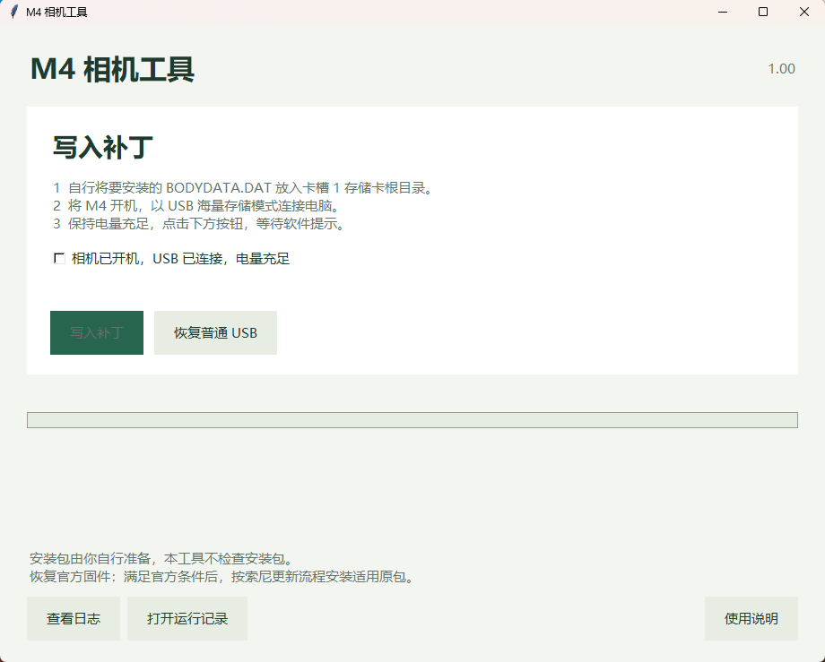
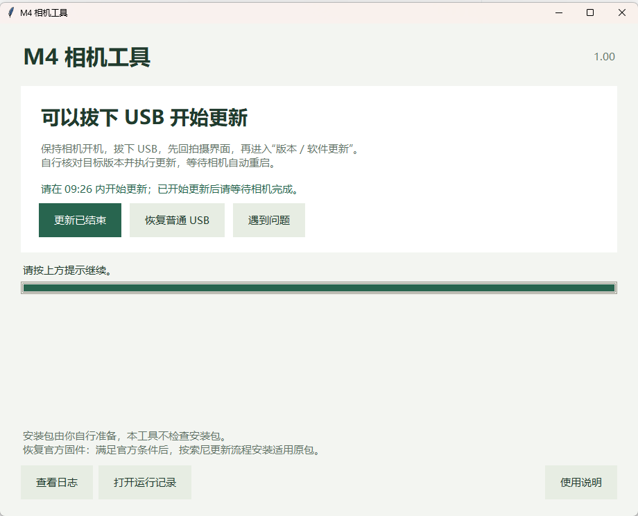
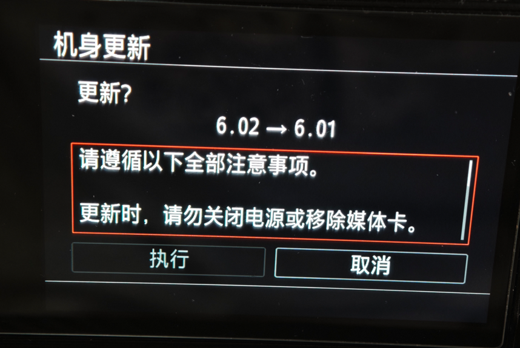
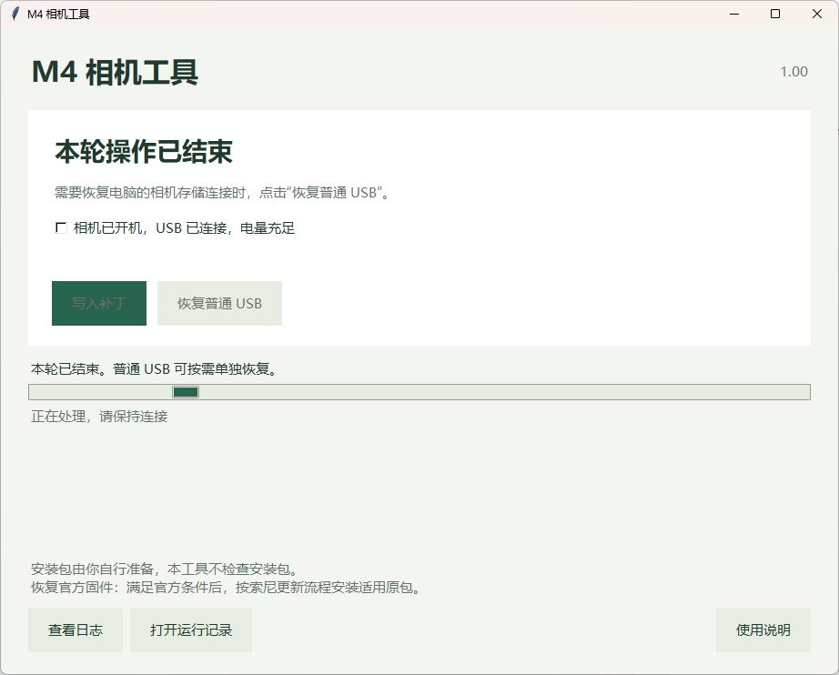
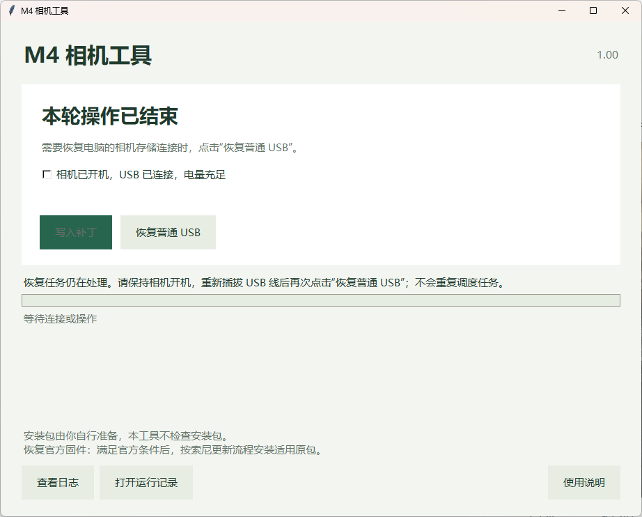

# 免 Fastboot 安装固件

[English](README.en.md) · [修改原理与位置](IMPLEMENTATION.md) · [M4 相机工具说明](TOOL-1.0.0.md) · [软件源码与构建](software/README.md)

> [!IMPORTANT]
> **安装前请确认适用范围：本固件适用于中国大陆销售的国行及香港销售的港版 Sony ILCE-7M4（A7 IV / A7M4），安装前固件版本须为索尼官方 V6.02。**
>
> **目前已有多台港版 A7M4 成功刷入的用户反馈。除国行与港版外，其他地区版本机身及其他固件版本尚未经实机测试，不在当前支持范围内。**

使用普通 USB 数据线准备 Sony ILCE-7M4 的更新环境，再由相机从 SD 卡安装 `BODYDATA.DAT`。此流程无需 Multi 接口刷机线、启动桥或进入 Fastboot。相机须能正常开机并进入 USB 海量存储模式；它不替代无法开机时的救砖工具。

从项目 [Releases](https://github.com/Erlla/sony-a7m4-custom-firmware/releases) 下载适用于本机的固件安装包和 **M4 相机工具**。

软件会实际修改更新环境分区 p1。操作前保留本机备份，使用原厂电池并满足更新器电量要求，保持稳定供电。工具自动备份的 p1 不等于全部 eMMC、校准或独立 CP NOR 备份。

## AI Agent 模式（1.03）

**模型建议：使用 [DeepSeek V4.1 Flash](https://api-docs.deepseek.com/news/news260910/)，或推理、代码与工具调用能力不低于该级别的大模型；Agent 还须具备联网、本机文件访问和命令执行能力。**

使用能联网、访问本机文件和执行命令的本地 AI Agent，复制[用户提示词](agent/USER_PROMPT.zh-CN.md)即可开始。Agent 会按[完整操作说明](agent/PROMPT.zh-CN.md)下载工具、检查环境、询问是否下载最新适用的固件／LUT／音频包，并逐步提示用户操作；实际写入前等待明确同意。

只需恢复电脑的普通 USB 连接时，直接说明“仅恢复普通 USB”，不进入固件安装流程。详见 **[Agent 入口](agent/README.md)** · [独立恢复](agent/USB_RECOVERY.zh-CN.md) · [正式运行包](https://github.com/Erlla/sony-a7m4-custom-firmware/releases/tag/A7M4-Agent-ToolKit-V1.03) · [Agent 源码](software/README.md)。

## 桌面软件模式（1.03）

### 1. 将固件放入存储卡

从 Release 下载 `BODYDATA.DAT`，直接放入**卡槽 1 存储卡根目录**，无需解压，不要放在子文件夹内。相机工具另外下载并解压；工具不会读取、校验或复制卡上的安装包。

### 2. 打开软件并写入补丁

完整解压 M4 相机工具至较短目录，例如 `D:\M4`。相机开机，以 **USB 海量存储模式**连接电脑，打开 `M4相机工具.exe`。

**软件需要管理员权限，请确认 Windows 管理员授权。初次使用需要安装相关驱动，耗时可能较长，请耐心等待。**

图 1 为软件刚打开的界面。确认相机和连接已准备好后，勾选**“相机已开机，USB 已连接，电量充足”**，点击**“写入补丁”**，等待程序执行。

程序会完成备份、检查、按需写入和独立完整回读。若中途提示重新连接 USB，保持相机开机，按提示重新插拔并继续，此时先不要在相机上更新。

若 p1 已完成、菜单连接失败，1.03 会提供“检查连接并继续菜单”，不要求重跑补丁。保持供电与连接后继续；需要恢复电脑连接时仍可独立使用“恢复普通 USB”。

### 3. 按提示拔线，在相机上更新

直到出现图 2 的**“可以拔下 USB 开始更新”**，才保持相机开机、拔掉 USB，先回到拍摄界面，再进入相机的**“版本／软件更新”**。

在图 3 的机身更新界面核对目标版本，选择**“执行”**并等待更新完成、相机自动重启。图中以 **6.02 → 自定义 6.01** 为例；6.01 是本项目自定义固件标签。

菜单窗口约 **10 分钟**，应在软件显示的剩余时间内开始更新。**更新开始后，不要关闭电源或移除存储卡，也不要因电脑端倒计时结束而断电。**

### 4. 更新结束后重新连接 USB

更新完成、相机正常开机后，检查版本、拍摄、保存和回放，再将 USB 重新连接电脑，点击图 2 中的**“更新已结束”**，在弹窗中确认相机已结束更新并进入拍摄界面。

软件将显示图 4 的**“本轮操作已结束”**。如需恢复电脑端的相机存储连接，点击**“恢复普通 USB”**，按软件提示继续。

若出现图 5 的**“恢复任务仍在处理”**提示，保持相机开机，按提示重新插拔 USB，再次点击**“恢复普通 USB”**，等待软件确认恢复。

“更新已结束”仅记录你的确认，不需要 USB 连接，也不会自动验证固件安装结果。重新连接 USB 是为了后续恢复电脑存储连接；是否恢复，以软件后续提示为准。“恢复普通 USB”不恢复官方固件。

## 恢复官方固件

恢复官方固件：自定义目标包的更新器必须保留正确的再次更新逻辑。在此前提下，自行取得适用且版本递增的官方原包，按索尼官方更新流程安装，无需再次运行补丁工具。本机已完成返回官方 6.02 的验收；具体条件见 [验证说明](VALIDATION.md)。

## 原理

普通 USB 服务入口执行受限原生工作器 → 完整读取并修补当前 p1 更新环境 → 临时放行两处 RAM 菜单版本检查 → 用户在相机执行 SD 卡更新。

当前接收端的签名状态返回成功 **0**，版本布尔判断返回真 **1**，另有两处局部版本拒绝结果改为成功。拍摄系统的两处菜单检查使用限时 RAM 修改，不永久改变版本页。完整位置和字节见 [IMPLEMENTATION.md](IMPLEMENTATION.md) 及 [patches.json](patches.json)。

保留 DAT 中原官方签名字节，不代表修改后的内容仍通过官方 RSA 验签。安装修改包依赖当前接收端补丁，不涉及索尼私钥，也没有生成新的有效官方签名。

## 兼容性与软件状态

工具按实际更新器、指令和布局判断兼容性，不按相机显示的版本号设置白名单。改变版本标签通常不需更换软件；关键代码不同仍会停止。没有验证任意版本、任意机型或任意 DAT 都能安装。

工具具备“写入补丁”和“恢复普通 USB”入口；用户手动放包，恢复官方仅提供说明。每轮保留完整性校验、完整 p1 备份和写后独立全读，不运行完整 ARM64 仿真或故障模拟。每次重开均建立新会话并显示初始界面，上次状态不锁住新会话；备份与日志保留。

完整便携包从 [Releases](https://github.com/Erlla/sony-a7m4-custom-firmware/releases) 下载。本目录另提供方法、配方、软件说明与 [软件源码及构建入口](software/README.md)，供开发者审查或自行构建。

## 致谢

免 Fastboot 安装方案参考了 [YuuLuo/a7c2-camera-tools](https://github.com/YuuLuo/a7c2-camera-tools) 项目的研究与实现思路，感谢其公开相关成果。

